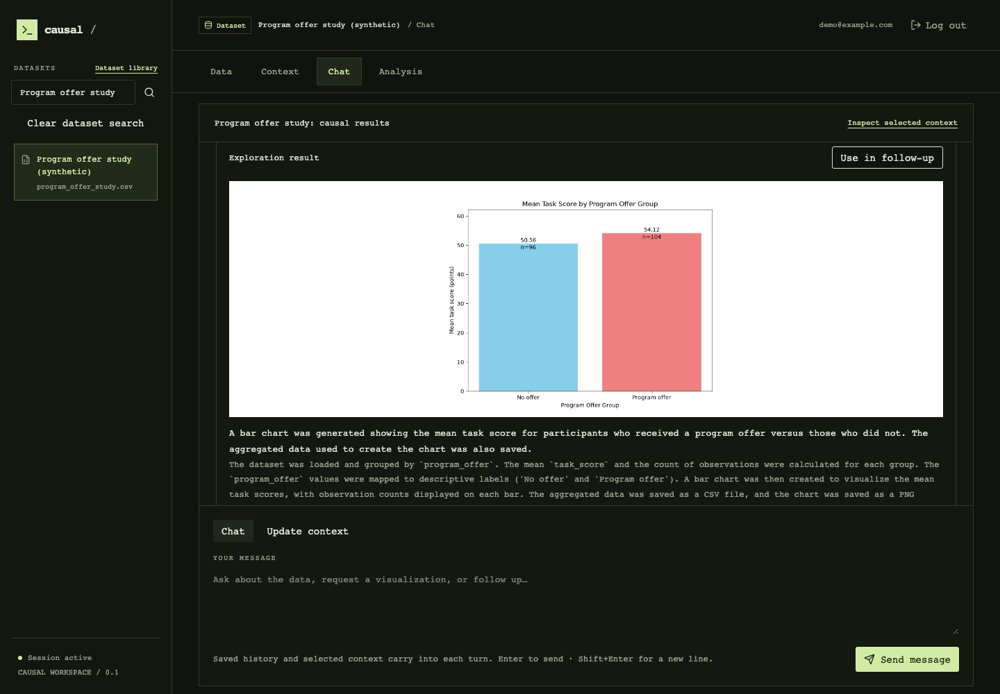
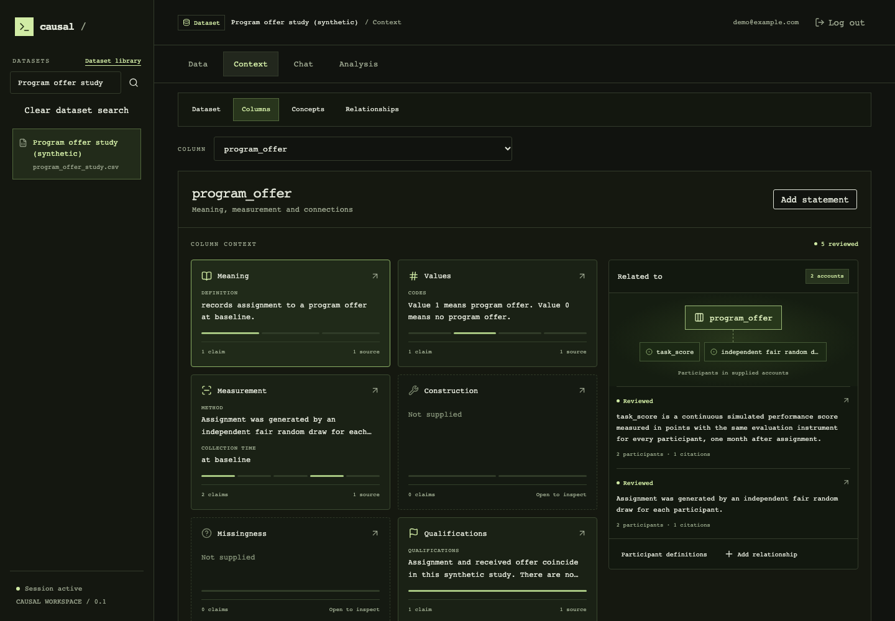
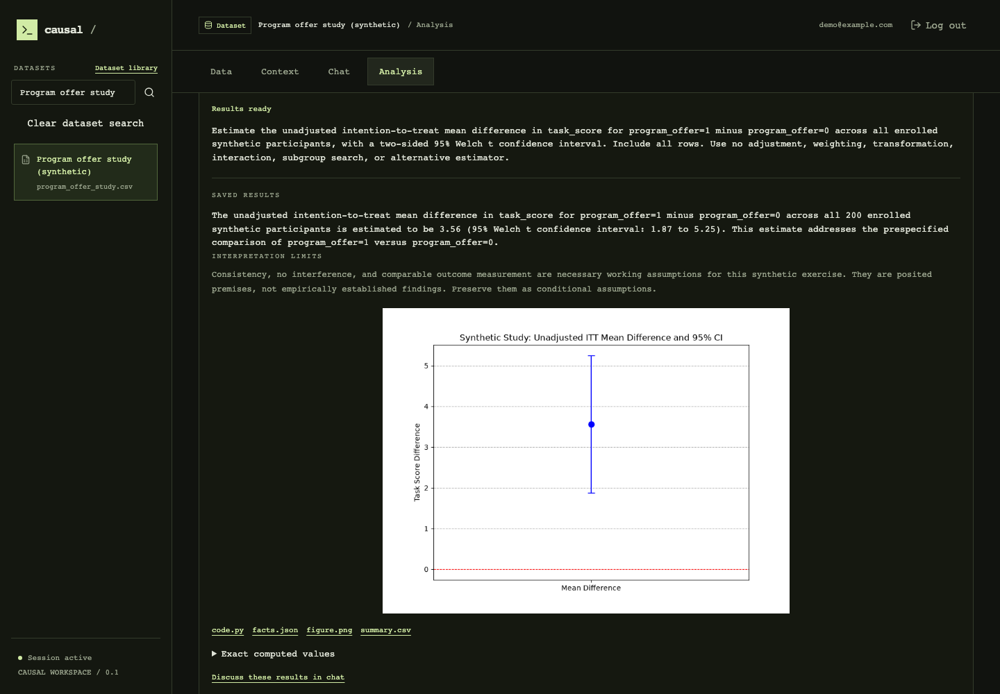

# Causal Workspace

An application for exploring data, developing study context, and carrying out inspectable causal analyses.

## Why I am building this

My background is in statistics, and it is the field I know best. That is why I chose to work on this problem.

When working with nondeterministic models, I think it is especially important to see what an answer depends on: the data, the supplied context, the assumptions, and the actual computation. A model's explanation can vary. The scientific question and the evidence behind a result should remain clear and inspectable.

For this problem, I think a useful balance of responsibility is to let the user guide and improve the study account, while the agent helps reason through the analysis. This application is my attempt to put that balance into practice.

## Data needs context

A causal analysis needs an account of what the data represents. Depending on the question, that includes variable meanings, how observations were collected, how treatment or exposure was assigned, the population, the comparison, and the timing.

The user can inspect that account, check its sources, and improve it through conversation. Relevant assumptions and unresolved information remain visible. Optional unknowns can stay unknown.

The aim is to give the agent enough context to work with, and give the user a practical way to understand and question its work.

## How responsibility is shared

**Chat** supports discussion, data exploration, and follow-up questions. **Update context** mode lets the agent propose improvements to the study account and analysis question. The user reviews those proposals and selects **Apply changes** to save them.

Once analysis starts, the applied context is the agreed, frozen input. Agents can retrieve existing details from it, but cannot add sources or send the user back through context preparation during that run.

Four bounded agents handle study understanding, analysis design, computation, and results explanation. They pass accepted findings downstream. Assumptions remain explicit, and numerical work runs as code. The user reviews and approves the exact program before target-effect execution.

The application keeps the inputs, approvals, computed evidence, and saved results available for inspection and further discussion.

## Inside the workspace

### Discuss data and inspect charts

Explore data in chat, inspect a computed chart, and use saved artifacts in follow-up questions. This chart is descriptive.

### Review context and its sources

Inspect the meaning of a column, its review status, and the source passages behind its statements.

### Review a saved analysis

Open the report, code, numerical evidence, and assumptions behind a saved result.

[See the six-image walkthrough](docs/screenshots.md). These captures use synthetic data in the running local application.

## Setup and documentation

The application runs locally with Docker Compose and a configured development account. It uses React, FastAPI, PostgreSQL, and LangGraph, with a separate worker and sandbox for computation.

- [Local setup and operations](docs/operations.md)
- [User guide](docs/user-guide.md)
- [Architecture](docs/architecture.md)
- [Testing and verification](docs/verification.md)
- [Full documentation index](docs/README.md)
