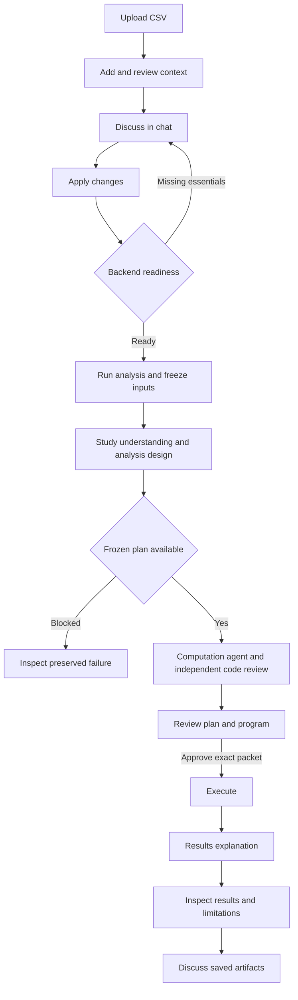

# Application overview

## Purpose

Causal Workspace supports a recorded causal-analysis workflow.
Users supply data and study context before analysis.
The application preserves the inputs, decisions, assumptions, code, approvals, and outputs.

The application has a terminal-style browser interface.
Users operate forms, buttons, tables, graphs, and inspectors.
They do not need to enter shell commands in the application.

## Application surfaces

| Surface | Main action | Saved result |
| --- | --- | --- |
| Login | Authenticate with the configured development account | A server-validated session |
| Dataset library | Upload, search, and reopen CSV data | Dataset metadata and immutable source bytes |
| Dataset preview | Inspect rows and original headers | No new scientific decision |
| Context workspace | Add sources and review keyed statements | Immutable context revisions |
| Chat | Discuss context, artifacts, and results | Ordered turns and replies |
| Update context mode | Propose edits and an analysis brief | An unsaved proposal until Apply changes |
| Analysis panel | Prepare, inspect, approve, and execute an analysis | Scientific receipts, programs, and artifacts |

## End-to-end workflow

Run analysis authorizes preparation with the applied context.
It treats that context as the agreed input and does not reopen context preparation.
It does not authorize target-effect execution.
The owner approves the frozen plan and program before that execution.

A necessary programming repair preserves the scientific snapshot.
The changed program requires renewed approval.
A statistical failure does not authorize a new causal plan.

## Runtime components

| Component | Technology | Responsibility |
| --- | --- | --- |
| Browser frontend | React and TypeScript | Display saved state and collect user actions |
| Web server | Caddy | Serve the frontend and proxy `/api` |
| API | FastAPI | Authenticate, validate, read, and submit operations |
| Domain database | PostgreSQL | Store authoritative records and transaction boundaries |
| Queue | Procrastinate | Deliver durable background jobs |
| Workflow engine | LangGraph | Store and resume chat and analysis position |
| Worker | Python | Run context, chat, and analysis jobs |
| Model adapter | Google Gen AI SDK with Vertex AI | Submit bounded model requests |
| Trace service | LangSmith | Record correlated diagnostic traces when configured |
| File store | Private local storage | Preserve source bytes and generated artifacts |
| Sandbox runner | Restricted Docker service | Execute generated Python |

The cloud architecture is a deployment target.
The delivered installation uses local storage and Docker Compose.
See [technology decisions](tech-stack.md) for the proposed Google Cloud services.

## Scientific boundaries

The applied context is the only supplied scientific authority for a new analysis.
Model familiarity with a dataset does not create authority.
Computations create observations about permitted data.
They cannot establish missing causal premises.

The harness separates columns, scientific variables, treatment values, assignment processes, and effects.
Several columns can encode one treatment.
Several treatments can share an assignment process.
Their presence does not imply independent assignment.

Supported representations include static contrasts, adoption-based effects, and discontinuity contrasts.
They also include estimates without conventional inference and nonstandard confidence sets.
Representation support does not establish numerical verification for every estimator.
Arbitrary treatment switching and history-dependent policy estimation remain unsupported.

## Operating boundaries

These boundaries describe the current operating scope. They do not turn implementation defects into acceptable behavior.

| Boundary | What it means in practice |
| --- | --- |
| Dataset intake | UTF-8 CSV with unique, nonempty headers and consistent row widths. Default admission limits are 10 MiB, 100,000 rows, and 200 columns. These are configurable limits, not a guarantee that every admitted dataset can complete analysis. |
| Supplied evidence | Context preparation accepts text, Markdown, and notes. Analysis uses the exact applied context pack as agreed input, with its qualifications retained. It cannot fetch sources, add context, or restart review during a run. |
| Scientific scope | The contracts represent static contrasts, absorbing adoption, and discontinuity designs. Arbitrary treatment switching and history-dependent policies are currently unsupported. A represented design is not automatically an identified or verified estimator. |
| Execution authority | Chat exploration is descriptive. Target-effect execution requires approval of the exact frozen specification and program. A repair cannot change the target or method after seeing results. |
| Bounded work | Agents, reviews, handoff submissions, and repairs share enforced allowances. The [analysis bounds](analysis-slice.md#bounds) and [chat limits](chat-slice.md#limits) define them. Reaching a ceiling can stop an otherwise in-scope request. |
| Numerical runtime | Generated code runs with the installed scientific libraries, without network access or package installation, and with a 60-second script timeout. See the [execution boundary](security.md#generated-code-boundary). |
| Current deployment | Local Docker Compose with a configured development account. Hosted deployment and identity-provider integration are outside this installation. |

Dataset defaults come from [configuration](../backend/config.py); [CSV admission](../backend/datasets/csv_data.py) enforces them.
Changing an admission limit does not establish performance or reliability at the new size.

## Where a run can stop

| Condition | Appropriate outcome |
| --- | --- |
| The requested effect is not identified under the agreed inputs and permitted assumptions | Explain the specific scientific obstacle. For example, the tested individual-effect request supplies only one factual outcome and forbids counterfactual imputation. An average effect cannot substitute for that request. |
| The requested method or treatment regime is not implemented | Return an unsupported outcome and preserve the request. This is a current capability boundary, not a claim that the scientific problem is impossible. |
| Calls, submissions, repairs, request size, or execution time exceed their allowances | Preserve accepted work and explain the exhausted resource. Exhaustion does not establish that the requested effect is unidentified. |
| The approved computation fails or its outputs fail validation | Preserve the failure. An allowed programming repair keeps the frozen method and needs fresh approval. Do not fabricate a result or silently choose another estimator. |
| A provider, worker, or runner is interrupted | Report an operational failure. Resume saved work when the recorded recovery action permits it; retain spent calls and completed tool receipts. An outage is not a scientific conclusion. |
| Approval refers to changed code, inputs, or runtime | Reject execution of the mismatched program. Approval must bind the exact version that will execute. |

Optional unknowns alone must not block analysis or trigger another context-preparation loop.
The system can still make interpretation or programming mistakes within its supported scope. Typed validation and independent review reduce this risk but do not prove every scientific conclusion correct.

See [verification](verification.md) for test coverage, numerical checks, and real-model acceptance procedures.
