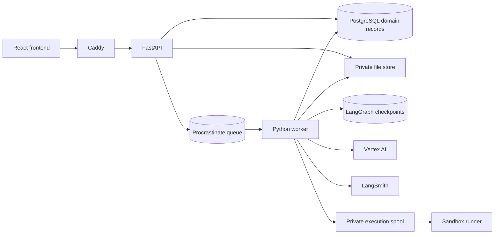
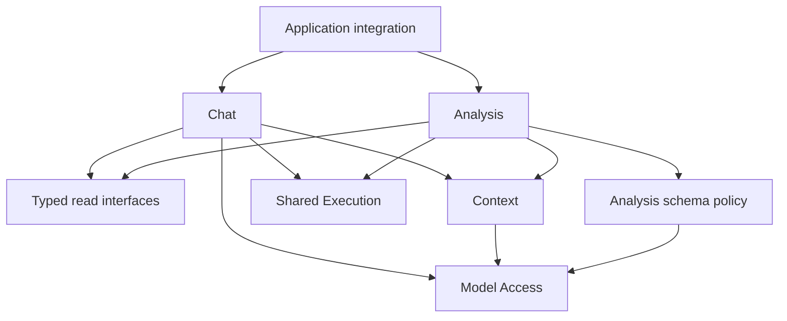

# Architecture and component ownership

## Scope

This document describes the current implementation.
It separates runtime components, domain ownership, and code dependencies.
The [component contracts](component-contracts.md) define handoffs between components.
The [data model](data-model.md) defines durable records.

## Runtime structure

The arrows show runtime interaction.
They do not represent Python import direction.

The API accepts requests and reads saved state.
Long model workflows run in the worker.
Browser disconnection does not cancel a queued job.
Context preparation uses a bounded worker loop without LangGraph.
Chat and analysis use LangGraph with PostgreSQL checkpoints.

## Component ownership

| Component | Entry points | Owns | Does not own |
| --- | --- | --- | --- |
| Account | `backend/auth.py` | Password verification and sessions | Dataset or scientific decisions |
| Dataset | `backend/datasets/routes.py`, `service.py` | Upload, owner queries, preview | Scientific meaning of columns |
| Context | `backend/context/routes.py`, `service.py`, `domain.py` | Sources, keyed statements, revisions, retrieval | Analysis conclusions or approvals |
| Chat | `backend/chat/routes.py`, `service.py`, `graph.py` | Conversation turns, context proposals, artifact discussion | In-place edits to a running analysis |
| Analysis | `backend/analysis/routes.py`, `service.py`, `agents.py` | Readiness, bounded agents, handoffs, approval, execution, reporting | New supplied context after launch |
| Model access | `backend/model_access.py` | Generic schema encoding, prepared requests, transport, validation, telemetry | Scientific schema policy or final acceptance |
| Storage | `backend/storage.py` | Immutable byte publication and checksum reads | Semantic interpretation |
| Queue | `backend/jobs.py`, `backend/integration/worker.py` | Job delivery and recovery scheduling | Scientific authority |
| Persistence | `backend/models.py`, `migrations/` | Relational schema and database invariants | UI state |
| Execution | `backend/execution/runner.py`, `docker/` | Restricted Python execution and receipts | Approval or causal redesign |
| Integration | `backend/integration/` | HTTP and worker dependency assembly | Scientific records or policy |

Paths in a row share the stated package prefix.
Chat and Analysis call the shared Execution adapter.
The Docker runner and its numerical environment retain their existing runtime identity.

## Analysis module boundaries

| Module | Responsibility |
| --- | --- |
| `contracts.py` | Typed scientific decisions, public views, and receipts |
| `readiness.py` | Structural checks of the applied analysis brief |
| `authority.py` | Claim admission and scoped assumption activation |
| `registration.py` | Registration of proposed assumptions and dependencies |
| `authority_view.py` | Derived inspector view of recorded authority decisions |
| `checkpoints.py` | Read-only historical checkpoint definitions and receipt views |
| `tasks.py` | Read-only historical task and attempt views |
| `agent_runtime.py`, `agent_store.py` | Native tool loops, durable reservations, receipts, budgets, and immutable handoffs |
| `agent_study.py`, `agent_design.py`, `agent_computation.py`, `agent_report.py` | Four stage-specific workspaces and typed submissions |
| `agent_review.py` | Isolated evidence readers and independent reviews |
| `packets.py` | Bounded evidence assembly and downstream claim selection |
| `references.py`, `effect_references.py` | Exact reference handles and accepted effect selection |
| `contrasts.py` | Typed comparison consistency |
| `lineage.py` | Diagnostic access decisions and projection rules |
| `domain.py` | Scientific consistency and deterministic validation |
| `code_checks.py` | Static program validation |
| `reporting.py` | Result manifest and reporting validation |
| `agents.py` | Four-agent orchestration, approval pause, execution, and recovery |
| `artifacts.py`, `discussion.py` | Saved catalogue, bound discussion views, file validation, and evidence classification |
| `records.py` | Program revisions and approval hashes |
| `provider.py` | Scientific schema choices, reference restoration, and thinking policy |
| `service.py` | Owner operations and public state projections |
| `delivery.py` | Atomic queue submission on the caller session |
| `jobs.py` | Worker execution ownership and domain recovery |
| `routes.py` | Authenticated HTTP parsing and response delivery |

These modules cooperate through typed records and saved receipts.
A receipt is authoritative only under the applicable acceptance rules.
A raw model response is not an accepted decision.

## Frontend boundaries

| Location | Responsibility |
| --- | --- |
| `web/src/app/` | Router, providers, authenticated shell, lazy feature loading |
| `web/src/features/auth/` | Login form |
| `web/src/features/datasets/` | Library, upload, preview, dataset navigation |
| `web/src/features/context/` | Sources, revisions, statement editing, analysis brief display |
| `web/src/features/chat/` | Conversation workspace, composer, exploratory artifacts |
| `web/src/features/analysis/` | Question, stage progress, approvals, results, and optional technical inspection |
| `web/src/components/ui/` | Shared accessible controls |
| `web/src/lib/api/` | Generated contracts and typed API clients |
| `web/src/styles.css` | Shared terminal-style tokens and layout rules |

The application conversation page composes Chat and Analysis.
Chat supplies display state through one typed side-panel slot.
The slot includes conversation identity, context selection, pending context changes, and selected analysis.
Chat and analysis reuse the context brief display.
These are presentation dependencies.
They do not transfer scientific decision ownership to the frontend.

## State ownership

| State | Owner | Persistence |
| --- | --- | --- |
| Remote records and request status | TanStack Query | Backend remains authoritative |
| Selected dataset, conversation, revision, analysis, workspace view, context return destination | TanStack Router | URL |
| Unsaved form edits | React Hook Form | Browser form state |
| Open inspector, mobile menu, selected follow-up files | Local React state | Browser session |
| Context, transcript, scientific decisions | Domain modules | PostgreSQL and immutable files |
| Workflow position | LangGraph | PostgreSQL checkpointer |
| Job delivery state | Procrastinate | PostgreSQL queue tables |
| Diagnostic traces | LangSmith | External trace service when enabled |

A page refresh can discard unsaved browser state.
It must not change saved scientific inputs.
The frontend renders progress from accepted receipts and task state.
It does not infer acceptance from a model call completing.

## Enforced code dependencies

These arrows show permitted dependencies, not control of scientific state.
Integration binds the read interfaces to their owning components.
Adapters use the caller's database session.
They do not own another catalogue or a global session.

| Importing area | Permitted dependencies | Boundary |
| --- | --- | --- |
| Chat | Context, read contracts, shared facilities | No Analysis or Integration import |
| Analysis | Context, read contracts, shared facilities | No Chat or Integration import |
| Execution | Shared configuration and storage | No Chat, Analysis, or Integration import |
| Model Access | Provider library and shared configuration | No Context, Chat, Analysis, or Integration import |
| Integration | Feature interfaces and entry points | No scientific policy or persisted state |
| Frontend application page | Chat and Analysis views | Typed composition slot; backend authority remains unchanged |

The Python check rejects foreign Chat/Analysis ORM imports and module imports that hide those records.
Both dependency checks follow re-exports and imports inside functions.
They reject prohibited literal dynamic imports.
Nonliteral dynamic imports in feature code are rejected because their targets cannot be checked.

Run [Python dependency checks](../scripts/check_dependencies.py) and [TypeScript dependency checks](../web/scripts/check-boundaries.mjs).
The backend test command and frontend lint command include these checks.

## Shared contracts and remaining reuse

`backend/handoffs.py` defines internal read contracts and detached views.
It creates no HTTP endpoint or persistent record.
`backend/validation.py` owns common validation and numerical-reference fields.
`backend/numerical.py` owns pure numerical checks.
Chat retains its evidence collection and context proposal logic.

`backend/responses.py` preserves the existing public reply shape.
Analysis owns `AnalysisReport`; public result serialization retains the historical reply fields.
The schema remains unchanged.

Chat and Analysis still reuse Context presentation and services.
Context owns the displayed concepts and saved revisions.
The central ORM schema remains in `backend/models.py`.
Import checks restrict each feature to its own records and shared records.

## Extension rules

Add a capability through its owning domain service.
Keep routes limited to HTTP concerns and operation dispatch.
Keep scientific acceptance in the backend.

Use an existing contract when consumers require the same meaning.
Do not make parallel copies of context or scientific state.
Keep generated API types derived from Python contracts.

Before changing a boundary, identify its callers, records, transactions, and recovery behavior.
Update the [handoff contract](component-contracts.md) and its verification references together.

Historical fixed-step execution is retired from the application. Saved records remain readable under their original contracts. Test-only fixtures in `tests/historical_analysis` preserve earlier scientific regression coverage; production imports of those fixtures are prohibited.
