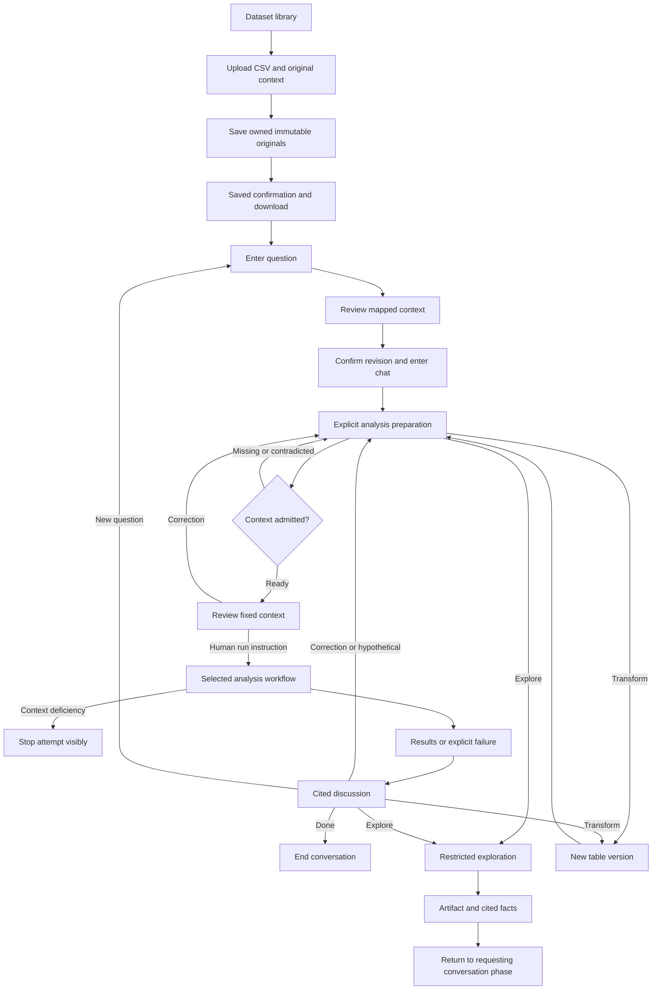
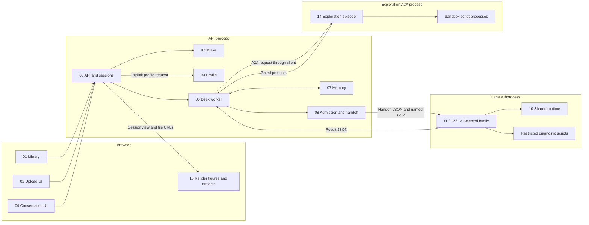
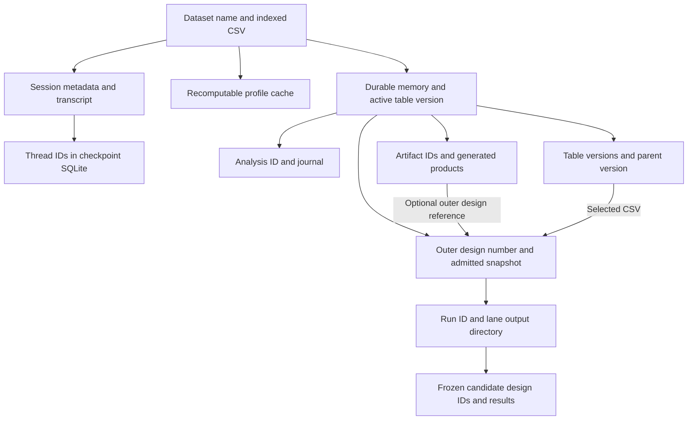

# Causal Agent component handbook

Start here to understand the application by function, then open one component at a time. Each chapter connects its purpose to the actual code, boundary contracts, decision authority, storage, failure paths and evidence.

Start with [the plain-language terms guide](terms.md) whenever a name is unfamiliar. For example, **execution machinery** means the shared code that runs workflow steps, checks answers, records attempts and handles failures. Component 10 explains that responsibility with a concrete example. Technical names are retained so you can find them in the code, but they should always connect to an understandable action.

This is a map of the current working tree, updated for consolidated chat on 26 October 2026, including existing uncommitted changes. It defines functional ownership, not a proposed package rename or service split. The conversation runtime now uses PostgreSQL revision and operation repositories. [Evidence and discrepancies](evidence.md) distinguish verified implementation from tests, retained runtime reports and unresolved behavior.

## Components and reading order

For the proposed next implementation, see [private user workspaces and production organization](../production/README.md) and its [data model](../production/data-model.md). These describe planned ownership and review features, separately from the current-code chapters below.

| ID | Component | Owns | Boundary |
|---|---|---|---|
| 01 | [Landing and dataset library](01-landing.md) | Dataset navigation, summaries and delete confirmation | Backend owns data and deletion |
| 02 | [Dataset intake](02-intake.md) | Staging, registration and deletion coordination | Profiling describes; sessions start the desk |
| 03 | [Dataset profiling](03-profiling.md) | Owned dataset/column reports; separate analysis profile cache | Data shape is not causal meaning |
| 04 | [Conversation interface](04-conversation-ui.md) | Messages, answer controls, ready view and inspectors | Displays backend decisions |
| 05 | [API and session runtime](05-api-sessions.md) | HTTP, workers, progress, checkpoints and projections | Desk owns conversational decisions |
| 06 | [Conversation desk](06-desk.md) | Question, interview, tools, authorization and discussion | Memory owns knowledge; lanes own analysis |
| 07 | [Dataset memory](07-memory.md) | Sourced fields, statuses and gated knowledge writes | Not a checkpoint or lane ledger |
| 08 | [Readiness and handoff](08-readiness-handoff.md) | Family fit, endpoint admission, fixed context and process launch | Lane cannot silently change context |
| 09 | [Artifact and persistence lifecycle](09-persistence.md) | Cross-component store inventory and lifecycle | Each actual writer retains its responsibility |
| 10 | [Shared code for running analyses](10-analysis-runtime.md) | Run workflow steps, check model answers, record attempts and collect results | Each specialist owns its causal methods |
| 11 | [Adjustment workflow](11-adjustment.md) | Structural reasoning, identification and frozen effect analysis | Own endpoints, engine and results |
| 12 | [Difference-in-differences workflow](12-difference-in-differences.md) | Adoption/comparison reasoning and panel targets | Explicit averaging and support |
| 13 | [Discontinuity workflow](13-discontinuity.md) | Threshold/locality reasoning and frozen RD analysis | Separate cutoff/window and receipt/eligibility targets |
| 14 | [Exploration and transformation](14-exploration.md) | Sandboxed scripts, requested products and new table versions | Restricted input and gated outputs |
| 15 | [Visualization and result presentation](15-visualization.md) | Structured figures, artifact display and cited result presentation | Producers, validators and renderers are distinct |
| 16 | [Infrastructure and verification](16-infrastructure.md) | Config, model calls, addresses, trace, dependency policy and checks | Shared mechanisms have named consumers |

Recommended sequence: **01–04**, then **05–08**, then **10–13**, then **14–15**. Keep **09** open when discussing any stored product, and **16** when discussing enforcement. The [source ownership index](source-index.md) assigns the current source, declarations, tests and tooling to these owners, including code spanning several functional areas.

## User journey and alternate paths

Exploration permission depends on whether the current table/context matches a frozen run. Transformation returns to preparation and does not authorize analysis. A new-analysis API action creates another thread and journal over the same memory. Recovering an interrupted worker resumes the existing checkpoint instead.

## Components and process boundaries

This diagram shows operational relationships, not Python import direction. The permitted import order is documented in [infrastructure](16-infrastructure.md). The API owns the desk worker threads. Family diagnostics reuse exploration's code-tool implementation, while the user-facing exploration episode runs over A2A. There is one conversation graph and separate specialist graphs.

## Boundary contract directory

| Boundary | Authoritative shape | Producer → consumer | Enforcement owner |
|---|---|---|---|
| Upload/registration | Multipart title/file/context/idempotency key → `IngestedDataset` | Intake ↔ frontend | Intake and server models |
| Owned profiling | `ProfileView`, `SavedColumn` | Details UI ↔ profiling API | Principal, owner/version constraints and generated types |
| Conversation wire | `MessageIn`, `SessionView`, `Prompt`, `Turn` | UI ↔ API/session manager | Server models, session guards, generated TypeScript |
| Question and knowledge | `QuestionFrame`, desk `Reading`, memory `Update`/`Field` | Desk → memory | Question validation, `ops.apply`, checks |
| Readiness | `EndpointCatalogue`, `ContextAdmission` | Family declarations → desk/lane | `assess_context`, identity/admission checks |
| Analysis handoff | `Handoff` | Desk → lane process | Handoff construction and `validate_context` |
| Bounded judgment | Caller schema and `EpisodeLog` | Model/tools → family or exploration | Shared episode plus caller gates |
| Reasoning to execution | Family `Design` extending `FrozenDesign` | Family reasoning → engine/execution | Seal and family-specific input checks |
| Result | Shared result dictionary and `RunRecord` | Lane → desk → session view | Family assembly, pipeline, server projections |
| Exploration | `ExploreRequest`, `Exploration`, `Trail` | Desk client ↔ A2A agent | Projection, sandbox and product gates |
| Persisted product | `Artifact`, `Version`, journal `Step` | Producers → shelves → readers | Memory shelf APIs and file-serving checks |
| Figure | `FigureSpec` | Family producer → UI/material | Figure gate and source-address checks |

Definitions, callers, important fields and failures are linked in each chapter. Cross-family result dictionaries are not falsely presented as a single exhaustive typed schema. Three built families execute analyses; four declared families participate through registry metadata and unsupported stubs.

## Storage relationships

The implemented saved-dataset journey uses `User → Dataset → Original version → CSV/context`, with stable column identities and dataset/column profile records beneath the version in PostgreSQL. See [profiling](03-profiling.md) for the exact schema and independent retrieval paths. The following diagram describes the separate analysis runtime, which is not connected to newly ingested datasets.

The [persistence chapter](09-persistence.md) names every store's actual path, writer, readers and cleanup behavior. Distinguish memory version, table version, analysis ID, thread ID, outer design number, frozen candidate design ID, run ID and artifact ID. They answer different identity questions.

## How to use and maintain the handbook

Explain unfamiliar terms at their first important use with a concrete action or example, and link to [the terms guide](terms.md). Keep precise code names alongside those explanations.

Every component uses the same nine sections: purpose/boundary, internal parts, inputs/outputs, contracts, decision authority, dependencies, state/storage, worked walkthrough, and verification. Walkthroughs illustrate inspected control flow; they are not claims that a new live run occurred.

For an individual component review, follow its walkthrough, inspect the linked contracts and gates, then check each outgoing boundary in the receiving chapter. Discuss code reorganization only after that ownership is understood. Any future move should update this map, source ownership, imports and contract consumers together.

The overview in [architecture](../architecture.md), detailed references in [the docs index](../README.md), and generated [ladders](../ladders) remain linked references. Do not copy endpoint declarations or generated schema fields into a second manually maintained specification. Archived ADRs and historical audits are not current component specifications.

The current saved-dataset journey also includes [Phase 4: organized context](phase4-context.md). This is separate from the existing conversational memory lifecycle.
