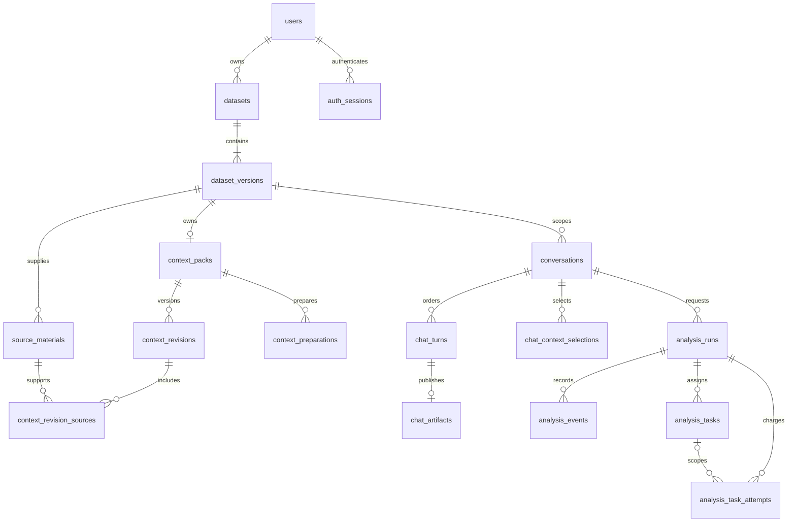

# Data model and lifecycle

## Authority

[SQLAlchemy models](../backend/models.py) define relational records.
[Alembic migrations](../migrations/versions/) define database changes and enforcement triggers.
Pydantic contracts define validated inputs and public views.
Generated frontend types are not a separate source of truth.

The database stores domain authority, job delivery, and workflow position in separate tables.
Private file storage contains source bytes and generated files.
A complete backup requires the database and referenced files together.

## Record ownership

| Table | Domain owner | Identity and lifecycle |
| --- | --- | --- |
| `users` | Account | Stable UUID and normalized email; password updates retain ownership |
| `auth_sessions` | Account | Hash of a random token; expires or is deleted on logout |
| `datasets` | Dataset | Stable owner-scoped identity; unique owner/submission pair |
| `dataset_versions` | Dataset | Immutable source metadata; unique dataset/version number |
| `source_materials` | Context | Immutable text or note bytes and metadata; version-owned |
| `context_packs` | Context | One pack per dataset version; mutable current-revision pointer |
| `context_revisions` | Context | Immutable content, parent, source membership, review state, and author |
| `context_revision_sources` | Context | Immutable revision/source membership with matching version |
| `context_preparations` | Context workflow | Frozen inputs; bounded calls; append-only processing evidence |
| `conversations` | Chat | Immutable initial dataset/context binding and title |
| `chat_turns` | Chat workflow | Ordered immutable request; processing state; immutable completed reply |
| `chat_artifacts` | Chat | Immutable output manifest published with a completed reply |
| `chat_context_selections` | Chat | Append-only selection created by an applied context proposal |
| `analysis_runs` | Analysis | Frozen inputs; workflow state; immutable science and append-only receipts |
| `analysis_events` | Analysis | Immutable run-local sequence, event key, summary, and detail |
| `analysis_tasks` | Analysis coordinator | Immutable task input and scope; fenced execution ownership |
| `analysis_task_attempts` | Analysis task store | Reserved attempt identity, provider evidence, metrics, and result receipt |

Program revisions, approvals, diagnostics, and executions currently reside in analysis receipt records.
They do not have separate relational tables.
Claim admissions and ledger entries reside in typed scientific receipts.
The authority inspector derives from those records.
It is not another writable ledger.

## Main relationships

Shared model attempts can have no task identity.
They still belong to the analysis run and its shared allowance.
Foreign keys and application checks retain exact version and owner relationships.

## Identity and immutable inputs

All timestamps use timezone-aware UTC.
Public responses exclude password hashes, session hashes, and internal storage keys.
Ownership normally derives through the dataset and its version.
A client cannot select another owner by changing an input field.

A column identity derives from dataset-version identity and position.
The original header remains display and source metadata.
Renamed or reordered datasets require explicit semantic mappings for cross-dataset comparison.
Their raw database identities are not expected to match.

A context revision stores all keyed statements once.
It also stores the optional reference-based analysis brief.
The current pack pointer can advance without changing previous revisions.
A conversation's applied context selection does not overwrite its initial binding.
Each turn freezes the selected revision at submission.

At analysis launch, the service stores these inputs:

- Dataset version and source checksum.
- Context revision and context hash.
- Applied analysis brief and finalized question.
- Readiness receipt and fingerprint.
- Analysis policy, model, and prompt contract.
- Recorded prior-exposure disclosure.

Runtime recovery verifies those inputs.
It does not read the newest context as a substitute.

## Operation states

| Record | States | Transition rule |
| --- | --- | --- |
| Context statement | `proposed`, `reviewed`, `unresolved`, `withdrawn` | A change produces a new revision |
| Context revision | `draft`, `reviewed` | Saved state is immutable |
| Preparation or chat turn | `queued`, `running`, `succeeded`, `failed` | Retry reuses frozen inputs and spent budget |
| Analysis run | `queued`, `running`, `awaiting_approval`, `succeeded`, `blocked`, `failed` | Approval and retry obey the current contract |
| Historical checkpoint receipt | `accepted`, `blocked`, `rejected`, `failed`, `exhausted` | The persisted attempt remains unchanged |
| Scientific task | `pending`, `running`, `accepted`, `rejected`, `blocked`, `failed`, `exhausted`, `expanded` | Ownership and accepted dependencies control publication |
| Assumption | `candidate`, `relied_upon`, `rejected` | Activation requires the permitted scientific phase and obligation |

A provider attempt marked accepted means that a typed proposal was received.
It does not mean that a scientific gate passed.
An agent needs a validated immutable handoff before its progress becomes complete.
Historical checkpoints retain their original receipt rules.

## Transactions and replay

| Operation | Atomic database result | Replay behavior |
| --- | --- | --- |
| Dataset upload | Dataset and initial version | Same submission and payload return the saved identity |
| Context save | Revision, source membership, pack pointer | Stale parent or changed submission conflicts |
| Background submission | Frozen operation and queued job | Duplicate work does not create another operation |
| Apply changes | Revision and chat context selection | Same applied proposal returns the saved revision |
| Task publication | Attempt receipt, accepted task state, event | Fenced ownership prevents stale publication |
| Checkpoint publication | Receipt and lifecycle event | Event keys prevent duplicate publication |
| Analysis approval | Exact approval receipt and execution job | Repeated exact approval reuses the receipt |
| Chat completion | Reply and exploratory artifact manifest | Completed content is immutable |

File publication and database commit are not one distributed transaction.
Storage publishes bytes before metadata references them.
A crash can leave an unreferenced file.
Automatic orphan deletion is deferred.

## Scientific and program records

The causal account freezes before diagnostics.
The executable scientific snapshot freezes the estimands and analysis policies.
Program revisions remain separate from that snapshot.
Approval binds the snapshot hash, program hash, and encoded runtime identity.

An approved program has one deterministic execution identity.
Its saved runner receipt supports recovery without choosing new code or inputs.
Programming repairs append revisions and preserve scientific choices.
Statistical failure does not authorize redesign.

Execution projections preserve source rows and selected decoded CSV strings.
The projection replaces selected headers with canonical identifiers.
It records source, projection, and manifest hashes.
It does not overwrite the source dataset.

## Storage and derived views

Original CSVs and context sources use server-generated private storage keys.
Reads verify content checksums.
Exploratory and analysis files use immutable manifests.
The sandbox spool is temporary transport, not the artifact repository.

The following are derived views:

- Dataset previews and row pagination.
- Context dependency projections and participant indexes.
- Frontend caches and form state.
- Checkpoint progress, graphs, and authority inspectors.
- Turn-bound artifact catalogues.

Derived views must preserve their input identity.
They cannot become independent scientific records.

## Migration ledger

The implementation schema head is `ab2840d19000`. Use `alembic current` to inspect an installation's applied revision.
The bounded-agent correction adds a run model limit, agent ownership and parent links on analysis tasks, provisional drafts, submission counts, immutable accepted handoffs and their hashes. Attempt records retain native provider conversation content and idempotent tool receipts. Historical tasks keep their existing meanings and null agent fields. LangGraph stores execution position; accepted handoffs remain domain records.
Analysis contract 19 adds typed JSON fields without a new SQL migration.
Analysis contract 20 changes Treatments wire-field encoding only; accepted scientific records retain the contract-19 authority policy.
The exact compact request and raw response remain in the existing provider attempt record.
Chat contract 7 exposes derived supported numeric values to reply generation without changing numerical admission or stored public reply fields.
Contract versions and schema revisions are separate identities.

| Revision | Added responsibility |
| --- | --- |
| `e710795a3a76` | Users, sessions, datasets, versions |
| `2b6e6c001001` | Immutable dataset-version protection |
| `c1791d5c399b` | Context sources, packs, revisions, and preparations |
| `5c0fb6c5cb1e` | Conversations, turns, and exploratory artifacts |
| `c410678d5e00` | Analysis runs, events, and applied chat context selections |
| `d83190ab4100` | Scientific checkpoint and approval protections |
| `f914c0a82000` | Durable tasks, attempt records, and shared budget counter |
| `ab2840d19000` | Bounded agent sessions, native tool receipts, immutable handoffs, and cumulative allowances |

The [Alembic revisions](../migrations/versions) define schema changes and their dependencies.
Do not rewrite historical snapshots to fit the current contract.
Incompatible active runs remain readable but cannot silently resume.

Run migrations explicitly before compatible application code starts.
A destructive downgrade is not a routine rollback.
See [operations](operations.md#release-and-rollback) for the release procedure.
