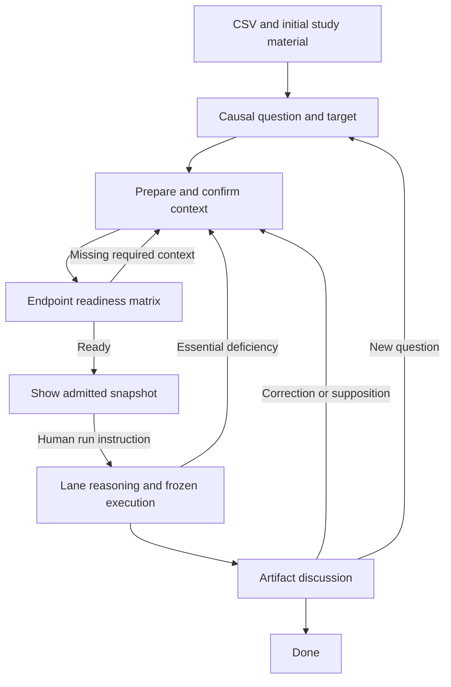

# The desk

One desk LangGraph: the question first, one question per turn until the matrix says ready, the run, then the
chat after. The desk is an operator. It receives, classifies, dispatches to a tool, gates what comes back, writes it, and asks
the next thing. No node reasons on its own; the amber nodes are the ones that call a model, each through a gate.

The node list is `build()` in [desk/graph.py:63](../causal_agent/desk/graph.py). Static edges are a dozen; the rest of the
routing is a `Command(goto=...)` returned by the node, so the route is always a decision code made from a typed result.

## The three interrupts

| interrupt | when | the payload | the resume |
|---|---|---|---|
| `ask_question` | the first turn, and again after a question the file cannot answer | the prompt for a causal question | the question text |
| `listen` | every interview turn | the next ask, the status strip, what is open, an artifact if one was asked for | the person's message, or `run` |
| `talk` | every turn after a run | the brief or the reply, a figure or a picture to show beside it | the person's message, or `done` |

The server resumes with `Command(resume=text)` and keeps the graph on a sqlite checkpointer, so a conversation survives a
restart. The page store keeps the transcript; the memory keeps what is known. The checkpoint holds only where the conversation is.

## The stages, in order

**The question first.** `read_question` is one judgement, a `QuestionFrame`, and `validate` is code: an effect of a change on an
outcome, the outcome a column that varies, the cause a column the file can tell apart. A question that fails is refused with the
test it failed ([desk/nodes/question.py:91](../causal_agent/desk/nodes/question.py)).

**Then the interview.** `check` runs the data checks and the consistency rules. `probe_fit` runs the probes and the matrix and
writes a `fit` step when a cell moves. `ask` composes the next thing by code ([desk/nodes/interview.py:288](../causal_agent/desk/nodes/interview.py)):

1. The map, once per question: which families the file could answer it with, what each still needs, which are struck and why.
   Then nothing is asked. The person talks about the data (drafted into the memory), asks for a picture, or asks the desk
   something, and each reply is only that, until they say they want to run.
2. The story, once the person wants to run: what the change was, who could get it and how that was decided, what each column
   records and when it was set, what one row is. The Reader drafts every claim it can from the answer. A mined note, or a
   story already told in the chat, skips it.
3. The readback ([desk/readback.py](../causal_agent/desk/readback.py)): the drafts grouped by the five claims every decision
   rests on, each line with the sentence it rests on. A yes confirms every draft shown. On the page it is a questionnaire:
   one item per draft with the desk's reading recommended, the other legal answers as chips and "other" for a value of the
   person's own; a changed line comes back as `address = value`, their word on that field, and the readback returns for the
   lines still drafted.
4. The gaps that block, asked by decision: the surviving families' decisions in the order each lists them, every open blocking
   field under one decision in one turn, prefixed "To settle <what the decision asks>, I need:". A belief is asked as what the
   design would bet on. The relations a decision merely rests on (the same thing as another column, nested in one, the effect
   could differ by it, an offer and an uptake as two columns) are not asked: they never block.
5. The ready moment: the routing nodes run (`fit`, `decide`, `gate`, `design`), the judge reads the pack once (`judge`: ready, risky or not ready, with the fields it would not trust; advice, never a block), then `convince` reads the assembled context back in the order the reasoning reads it, the
   pair, the mechanism, time, the relations, the hidden factors, heterogeneity, the threats, then names the design and what it
   bets on. The person corrects any line there, in words or on the page's handoff view (which sends `address = value` lines:
   their word on each field, written confirmed, read by no model), or says yes, and the yes is what launches.

Exact endpoint requirements and decisions are generated in the [lane catalogues](lanes.md).

`listen` takes the answer. `infer` is the Reader over it; on the story turn the desk also keeps the account whole, as the
one verbatim field only it may write. `explore` and `explain` serve an artifact or an answer before the next ask. A decision model (Laya, or Jev on the same wire;
`desk/turns.py`, `desk/decider.yaml`) reads the kind of every turn first, cheaply, and a confident explore, ask, run or transform (a change to the table: a new version the data agent writes, put in play on the person's word) never reaches
the Reader, except at the ready moment, where the Reader always reads the word; when it is unsure the Reader reads the kind; a run anywhere but the ready moment turns run intent on, after which only what blocks is asked, and a
run at the ready moment is the word that launches. No word list is matched.

**The routing, by code.** `fit` computes the matrix; `decide` is code when exactly one family survives and a judgement only when
several do; `gate` checks the decision; `design` is the Designer writing the brief; `handoff` writes `designs/<n>/` with the
memory snapshot, the pack, the brief and the matrix.

**The run.** `run` starts the lane in its own process on `handoff.json` ([desk/pipeline.py](../causal_agent/desk/pipeline.py)),
writes source-backed relationship proposals as memory drafts, and writes the record.
`context_deficiency` returns essential omitted addresses to the desk, clears readiness, and requests clarification. The corrected context receives a new identity and requires another human run authorization.

**The chat after.** `brief` renders the opening message from the material ([desk/material.py](../causal_agent/desk/material.py)):
the answer, the caveats, the checks that did not pass clean, the falsifications and sensitivities, where the lane disagreed with the pack, the figures.
`turn` is the Explainer routing each message: answer, revise (back through the gate and the checks), what_if (on a copy of the
memory, a new context snapshot and a fresh authorization), requestion, explore, done.

## Watching the desk in Studio

`make studio` starts `langgraph dev` on port 2024 with the server's pickled threads wiped, and the desk graph is registered in
`langgraph.json`. Open `https://smith.langchain.com/studio/?baseUrl=http://127.0.0.1:2024` in your own browser, in Chrome
rather than Safari, which refuses a page's calls to a plain-http local port. Sign in to LangSmith once; the server and every
thread stay on your machine. Pick `desk`, give `{"dataset": "students"}` as the input and submit. The first stop is the
question interrupt: resume with the question text. Every later interrupt shows the `text`, the `ask` and the `status`; resume
with your answer, or `run`, or `done`.

Click a node to read what it wrote. `memory` is the memory as it stands after that node saved it, mirrored into the state for
this view and read by no node; the diff against the node before is what the turn changed. `settled_now` is the list of
addresses this turn wrote. `infer_errors`, `explain_errors`, `gate_errors` and `after_errors` are the gate refusing a
judgement, try by try. `status`, `matrix` and `open` are the fit. `debug` holds one `Thought` per model call, so a node with
none ran as code. The judgement nodes are `mine`, `prefilter`, `read_question`, `infer`, `explain`, `explore`, `decide`,
`design`, `judge` and `turn`; every other node is code (`convince` only says what the routing nodes made). `run` is one box, because the lane runs in its own process; watch a
lane in its own graph ([lanes.md](lanes.md)). With `LANGSMITH_TRACING=true` in `.env`, Studio links each node to its trace,
where the prompt text is; without it, the state is the record.

## The journal

Every step writes itself into `analyses/<id>/journal.jsonl` through `record` ([desk/nodes/shared.py](../causal_agent/desk/nodes/shared.py)):
the kind (question, claim, fit, explain, design, run, brief, answer, what_if, revise, requestion, explore), who did it (code, model,
person), the memory version at that moment, what it read, what it left. A step's address is `step:<n>` and the Explainer may cite one.

## The same nodes without the interview

`route(question, dataset)` in [desk/route.py:36](../causal_agent/desk/route.py) calls the same node functions in order on a plain
dict: load, mine, prefilter, frame, fit, decide and gate up to three times, design, handoff. The evals and the command line use it.
There is no second graph and no second implementation of the routing.

The judgements and their gates are tabulated in [gates.md](gates.md).
