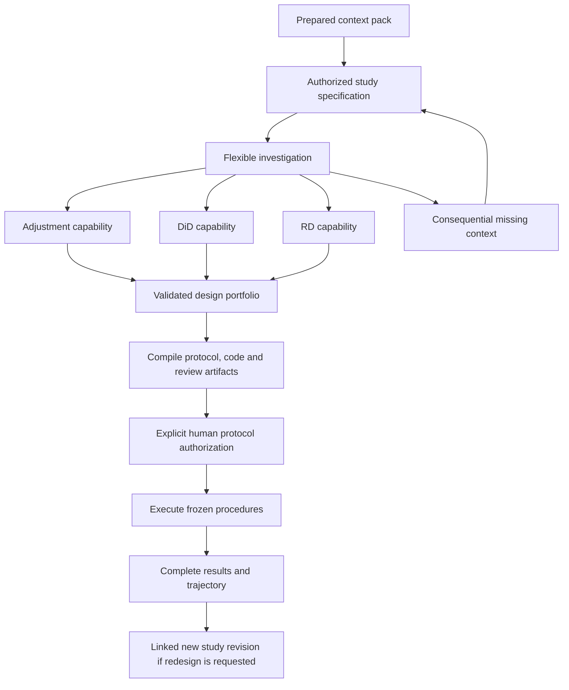

# Causal analysis agent: scientific architecture

Written: 27 October 2026.

Status: accepted design direction, proposed implementation. This document records the research-grounded architecture agreed in the planning conversation. It does not claim that the proposed capabilities are implemented or validated. Implementation and desk integration are specified in the companion [collaboration and desk integration plan](causal-agent-collaboration-and-desk-integration.md).

The architecture is intentionally based on scientific obligations rather than the present code layout. The companion plan maps it onto the application and clearly distinguishes current behavior from proposed changes. Existing [architecture](../architecture.md) and [gates](../gates.md) describe the current system until implementation changes them.

## 1. Decision and scope

Build one study agent with three specialist capabilities: adjustment, difference in differences, and regression discontinuity. Give the agent freedom to investigate within an explicit scientific contract.

The starting input is the prepared context pack, one dataset version and one primary causal question. The agent establishes the target, measurement process and assignment account before narrowing the available designs. Several designs may remain admissible. Preserve ambiguity when the evidence cannot resolve it.

The agent may investigate every column, propose coherent causal accounts, request consequential missing context, examine eligible designs and assemble an analysis portfolio. It may not confirm its own assumptions, grant itself access, redefine the target after seeing effects, or select a favorable result for reporting.

The end product is an auditable study: its assumptions, graphs, identification arguments, executable protocol, estimates where justified, companion analyses, declared fallbacks, refutations, sensitivity analyses, inference objects, limitations and trajectory. An unidentified or unsupported target is a legitimate completed scientific assessment.

The six research departments are responsibilities for architecture review. Production does not require six agents continuously debating every tool call. Use a common planner, bounded specialist episodes and an independent protocol critic. Typed operations and deterministic validators own enforcement.

## 2. Research ownership and what the evidence establishes

Each specialist owned five primary papers or documented systems. The combined architecture is our engineering proposal. None of these sources validates this complete autonomous causal-analysis system.

| Department | Five owned sources | Supported lesson and boundary |
|---|---|---|
| Ontology | [Gruber, 1993](https://tomgruber.org/writing/ontolingua-kaj-1993.pdf); [PACT, 1993](https://www.researchgate.net/profile/Richard-Fikes/publication/2954163_PACT_An_Experiment_in_Integrating_Concurrent_Engineering_Systems/links/54107c620cf2f2b29a410de5/PACT-An-Experiment-in-Integrating-Concurrent-Engineering-Systems.pdf); [OptiqueVQS, 2018](https://journals.sagepub.com/doi/10.3233/SW-180293); [Kosten et al., 2025](https://www.frontiersin.org/journals/artificial-intelligence/articles/10.3389/frai.2024.1454258/full); [OaK, 2026](https://arxiv.org/html/2608.22974v1) | Shared semantics, constrained navigation and typed functions help systems cooperate. Consistency does not establish truth or completeness. OaK freezes its constructed kernel before unseen inference; it does not justify rewriting causal rules after effects. |
| Causal methods | [Shpitser and Pearl, 2006](https://ftp.cs.ucla.edu/pub/stat_ser/r327.pdf); [Perkovic et al., 2018](https://jmlr.org/papers/volume18/16-319/16-319.pdf); [Hernan and Robins, 2016](https://dfcm.utoronto.ca/sites/default/files/inline-files/emulating_randomized_trials.pdf); [Roth, 2022](https://www.jonathandroth.com/assets/files/roth_pretrends_testing.pdf); [Nosek et al., 2018](https://doi.org/10.1073/pnas.1708274114) | Identification is conditional on the supplied account. Some structural uncertainty can remain without preventing identification. A registered diagnostic-selection rule can still produce invalid inference. |
| Harness and tools | [AppWorld](https://aclanthology.org/2024.acl-long.850/); [LangGraph persistence](https://docs.langchain.com/oss/python/langgraph/persistence); [Agent Skills specification](https://agentskills.io/specification); [AgentDojo](https://arxiv.org/html/2406.13352v3); [tau-bench](https://arxiv.org/html/2406.12045v1) | Discoverable APIs support flexible trajectories. Permissions, scientific authority and recovery require application enforcement. A correct final state can conceal a missing required approval. |
| Memory | [ACE](https://arxiv.org/html/2510.04618v3); [Mem0](https://arxiv.org/html/2504.19413v1); [Trace2Skill](https://arxiv.org/html/2603.25158v5); [GEPA](https://arxiv.org/abs/2507.19457); [RecMem](https://arxiv.org/html/2605.16045v1) | Retrieval, structured playbooks and offline skill improvement can help agents. Usefulness, repetition and recurrence do not confer scientific authority. Rare critical instructions must survive summarization. |
| Human review and visibility | [Amershi et al.](https://www.microsoft.com/en-us/research/wp-content/uploads/2019/01/Guidelines-for-Human-AI-Interaction-camera-ready.pdf); [Horvitz](https://erichorvitz.com/chi99horvitz.pdf); [Bansal et al.](https://arxiv.org/html/2006.14779v3); [Bucinca et al.](https://kgajos.seas.harvard.edu/papers/bucinca21trust.pdf); [W3C PROV-O](https://www.w3.org/TR/prov-o/) | Support contextual explanation, correction and meaningful control. Explanations can increase agreement without improving correctness. Provenance describes origins and responsibility; it does not establish truth or enforce access. |
| Evaluation | [AppWorld](https://aclanthology.org/2024.acl-long.850/); [tau-bench](https://arxiv.org/html/2406.12045v1); [AgentBoard](https://arxiv.org/html/2401.13178v2); [LangSmith trajectory evaluation](https://docs.langchain.com/langsmith/trajectory-evals); [CausalReasoningBenchmark](https://arxiv.org/html/2602.20571v3) | Evaluate intermediate decisions, repeated reliability and final results separately. A reference paper, matching estimate or familiar tool sequence is insufficient as a scientific correctness oracle. |

### Decisions changed by the debate

1. Hiding effect estimates is insufficient. Diagnostic summaries, rankings, exclusions and error messages can influence design. Outcome-derived diagnostics run after protocol approval by default.
2. Freezing every numerical value would exclude legitimate procedures. Freeze executable algorithms and allowed adaptations. Supported numerical procedures may calculate data-dependent bandwidths or nuisance fits during execution.
3. A deterministic compiler cannot sanitize an arbitrary outcome-informed recommendation. Its decision rules must already have a methodological justification and authorization.
4. Runtime checkpoints, scientific commitments and human approvals are different objects. Rewinding execution cannot rewind exposure or scientific history.
5. A full live trace can disclose protected evidence. The user journey and trace payloads need the same disclosure rules as model contexts.
6. Independent review must evaluate authorization, information use and scientific obligations. A correct final number cannot compensate for an invalid trajectory.

## 3. The scientific ontology

### 3.1 Objects and authority

| Object | Required content | Authority boundary |
|---|---|---|
| StudySpec | Units, population, intervention, comparator, outcome, time zero, horizon, causal contrast, scale and aggregation | Human intent fixes the requested question; methods cannot silently change it |
| VariableAccount | Measured construct, reference period, collection time, units, derivation, availability and missingness interpretation | Semantic proposals remain sourced proposals until accepted through the applicable authority path |
| CausalAccount | Named coherent assumptions, assignment mechanism, structural relations, measurement and selection account, relevant unmeasured constructs | A human-authorized account is still an assumption about the world |
| EvidenceRecord | Source identity, supporting passage or computation, revision, scope, access restrictions and permitted decision uses | A statistical fact cannot silently become a causal assumption |
| CandidateAssessment | Exact target and account; identification, implementation, data-support and inference assessments; dependencies | Numerical success cannot resolve missing identification |
| DecisionEvent | Proposal or accepted change, evidence, alternatives, reason, actor, revision and downstream consequences | A model cannot write an accepted commitment directly |
| ProtocolManifest | Complete executable procedures, artifacts, inference, adaptation, fallback and reporting rules, code and data identities | Exact-version human authorization is required before execution |
| ExposureEvent | Information made available, actor or audience, purpose, timing and lineage | New contexts and replays cannot erase prior exposure |
| AnalysisBundle | Protocol, accounts, certificates, attempts, estimates, diagnostics, sensitivity, inference, limitations and provenance | Retains failures and incomplete execution alongside successful outputs |

Keep source assertions, model proposals, conditional assumptions, observed facts, formal derivations and authorizations distinguishable. Repetition or retrieval never changes one category into another.

### 3.2 Columns and conditional roles

Every column receives a disposition: substantive construct, identifier, time or index, derived measure, selection indicator, duplicate, irrelevant to this question, or unresolved. Coverage means an accountable disposition, not compulsory adjustment.

Causal roles are relative to a target and account. A variable can participate in different paths and have different roles under different accounts. Collider status is path-dependent. Store the relationships and derive the role explanation; do not persist one global confounder label per column. Relevant unmeasured causes must be representable without CSV columns.

Separate a construct's reference period from the time it was collected. A questionnaire administered later can ask about an earlier period, and a purported baseline field can summarize post-treatment experience. These distinctions can change admissibility.

An unknown relationship must remain unknown. Omitting an edge from a compiled causal graph is a substantive commitment within that graph's stated scope. Retain alternative coherent accounts or a formally supported graph class rather than independently toggling arbitrary arrows into incoherent combinations.

### 3.3 Four independent candidate assessments

1. Identification: what causal quantity follows under the stated account?
2. Implementation: does a supported numerical procedure exist for that identified quantity?
3. Data support: do these observations satisfy the procedure's relevant support requirements?
4. Inference: is the uncertainty calculation justified, including selection and adaptation?

Failure of adjustment does not establish failure of every identification strategy. Symbolic identification does not imply an available estimator. DoWhy's general ID return object differs from its usual identified-estimand object, reinforcing the need for an explicit adapter boundary. [DoWhy ID documentation](https://www.pywhy.org/dowhy/v0.14/user_guide/causal_tasks/estimating_causal_effects/identifying_causal_effect/id_algorithm.html)

### 3.4 Dependency-driven pruning

Every accepted derivation names the exact inputs and revisions it uses. Changing a relevant input invalidates dependent conclusions. Unrelated changes do not invalidate everything merely because they occurred later.

Examples:

- A changed reference period invalidates dependent adjustment proposals.
- A total-effect target constrains adjustment through the applicable graphical criterion.
- An effect at an RD cutoff is not interchangeable with an effect in a score neighborhood.
- A changed adoption date changes eligible DiD comparison cells and follow-up.
- Choosing never-treated versus not-yet-treated comparisons carries different assumptions. [Callaway and Sant'Anna](https://arxiv.org/html/1803.09015v3)

When a supported identification argument works across represented structural uncertainty, retain that result without forcing a single graph. Generalized adjustment supports this for specific graph classes under its assumptions. A hand-built set of plausible graphs must not be mislabeled a CPDAG or PAG. [Perkovic et al.](https://jmlr.org/papers/volume18/16-319/16-319.pdf)

## 4. AppWorld-style capabilities, skills and enforcement

AppWorld motivates a world of documented, composable operations with multiple acceptable trajectories. It is an environment and benchmark, not a complete scientific-agent architecture. Its API breadth does not supply causal validity or production isolation. [AppWorld](https://aclanthology.org/2024.acl-long.850/)

Expose a discoverable capability directory:

| Group | Operations |
|---|---|
| Context and measurement | Inspect sources, account for columns, resolve references, record deficiencies |
| Causal accounts | Propose hypotheses, check temporal consistency, compare accounts, derive conditional roles |
| Identification | Apply supported graphical criteria, assess assignment assumptions, produce certificates or blockers |
| Design | Enumerate compatible procedures, inspect permitted support facts, assess inference |
| Protocol | Compile code and artifacts, validate dependencies, prepare review, seal |
| Execution and reporting | Execute approved procedures, run declared diagnostics, audit completeness, explain results |

Each operation declares input and output types, preconditions, evidence permissions, permitted decision influence, independent validators, dependencies, failure consequences, resource costs and retry policy. A capability broker checks these on every invocation.

The planner selects from the currently permitted action set. It can choose investigation order, pursue a consequential uncertainty and propose new accounts. It cannot make an action admissible through persuasive prose or by discovering its documentation.

Skills teach methodology, examples, failure cases and tool usage through progressive disclosure. Runtime code enforces permissions. A skill's tool list is not the security boundary. Pin the skill and method-library version for each study. [Agent Skills specification](https://agentskills.io/specification)

Generated diagnostic code receives only its authorized data projection inside the mandatory isolated sandbox. It cannot read the full dataframe, credentials, unrestricted files or network through another tool. Missing isolation is a visible failure. New numerical methods require a reviewed capability release with sources and tests, rather than live self-extension during a study.

Parallel specialists receive immutable input revisions. Conflicting proposals require reconciliation; completion order must not determine scientific authority. Evidence and budget restrictions apply across child episodes, retries and caches.

## 5. Scientific flow and human lock-in

These are scientific boundaries, not one fixed sequence of individual tool calls.

| Checkpoint | Required state | Human involvement |
|---|---|---|
| Study identity | Exact target, dataset and context identities, investigation scope, resource budget and known exposure | Authorize the investigation, or reuse an authorization already covering this exact contract |
| Measurement and accounts | Column coverage, assignment and measurement account, coherent alternatives and consequential unknowns | Supply missing substantive knowledge when needed |
| Candidate assessment | Identification, implementation, support and inference assessments with dispositions for relevant candidates | Resolve consequential preferences or assumptions that evidence cannot settle |
| Executable protocol | Complete procedures, code, artifact definitions, inference, fallbacks and reporting rules | Explicitly approve this exact version |
| Results closure | Every planned attempt has an outcome or an explicit nonexecution reason | Discuss findings and authorize any subsequent study |

The desk remains the human-facing interlocutor. Specialists return typed deficiencies to it rather than independently interviewing the person. Ask about treatment assignment, measurement timing, population and substantive assumptions, not whether the person approves a technical label such as confounder.

Approval records a commitment and authorization, not causal truth. Unknown is a valid answer. A person cannot override a failed numerical or structural requirement by reasserting a belief. Questions already answered unknown should not recur without new evidence or a changed obligation.

### Three method capabilities

- Adjustment/DoWhy: explicit causal accounts, supported identification, valid adjustment where applicable, support, estimator and inference contracts. General identification may return an expression that the execution catalogue cannot implement; report that boundary honestly.
- DiD: adoption timing, comparison groups, anticipation, parallel-trends assumptions, cohort-time targets, aggregation and inference. Do not equate a nonsignificant pretrend test with established parallel trends.
- Discontinuity: score, cutoff, eligibility versus receipt, continuity or local-randomization account, local support, bandwidth or window rules and appropriate inference.

DiD and RD can have causal diagrams. Their full identification assumptions additionally require temporal, functional or assignment restrictions. In RD, changing from a cutoff effect to a neighborhood effect can change the target. Weak assignment and discrete scores require explicit method-specific treatment. [RD extensions](https://arxiv.org/html/2301.08958v2)

Assess all relevant capabilities before narrowing the design set. Do not force all three to execute, and do not route exclusively before the assignment process and target are understood.

### Portfolio and end contract

The protocol contains the primary question and interpretation, retained accounts, justified primary procedure where one can be designated, purposeful companions, sensitivities, refutations, equivalent-target technical fallbacks, inference and multiplicity rules, stopping conditions and reporting obligations.

When designs remain scientifically incomparable, retain conditional results or ask for the substantive commitment needed to distinguish them. Do not invent a universal best-estimator ranking. A companion must have a scientific purpose rather than merely adding another opportunity for significance.

Comparability requires matching population, treatment strategies, contrast, horizon, scale, support, weights and aggregation. A change to any of these is visible in the target contract. If the primary fails, it remains primary and failed. A successful companion is not silently promoted. If no valid fallback exists, report its absence.

Preserve asymmetric intervals, disconnected or unbounded confidence sets, unavailable inference and computational failures. Do not coerce every result into a point estimate and Wald interval.

## 6. Invariants against outcome-informed redesign

| ID | Enforced rule |
|---|---|
| I01 | No execution without authorization matching the immutable protocol and dataset/context identities |
| I02 | No model promotion of a proposal into an accepted causal belief |
| I03 | Every decision uses only evidence allowed for that actor and that decision purpose |
| I04 | No diagnostic result creates new discretionary method-selection authority |
| I05 | Target and procedure identities cannot change during frozen execution |
| I06 | All planned attempts, failures, deviations and unresolved obligations remain visible |
| I07 | Exposure history survives context resets, branches and checkpoint restores |
| I08 | Changed dependencies invalidate affected certificates, designs and approvals |
| I09 | No silent primary replacement or comparison of incompatible targets |
| I10 | Critical constraints survive retrieval, summarization and context compaction |
| I11 | Resource limits apply across episodes and retries; exhaustion reports incomplete coverage |
| I12 | Scientific authority is independent of chat wording, trace presentation and runtime cursor |

Default design contexts receive approved outcome-free facts. Outcome-derived diagnostics, including DiD pretrend plots and tests, execute after final protocol authorization. Known outcome-derived columns, summaries, filenames, errors, caches, source passages and artifact links must pass the same access policy. Valid baseline measurements require their own measurement and permitted-use account; predictive association alone does not make every baseline covariate prohibited.

Outcome-free does not automatically mean inferentially harmless. A diagnostic that changes inclusion, weighting, estimator or inference needs an approved influence rule. Passing a check does not establish the underlying causal assumption.

Freeze the executable algorithm, its permissible inputs, tuning and adaptation rules, inference, randomness where applicable, and reporting behavior. Numerical procedures can compute data-dependent quantities after authorization. The model and person cannot replace those procedures after inspecting outputs while presenting them as the original plan. Robust RD inference with appropriate bandwidth selection is an example of legitimate supported adaptation. [Calonico, Cattaneo and Titiunik](https://rdpackages.github.io/references/Calonico-Cattaneo-Titiunik_2014_ECMA.pdf)

The initial workflow has no general exception for outcome-informed preapproval design. A future exception requires a separately reviewed method capability with a specific selection-and-inference justification. Isolation and deterministic compilation alone do not provide that justification.

Prespecifying “use DiD only if pretrends pass” does not remove pretesting problems. Diagnostics inform declared sensitivity and limitations rather than silently choosing which result to report. [Roth](https://www.jonathandroth.com/assets/files/roth_pretrends_testing.pdf) Sensitivity methods can instead state conclusions under explicit restrictions on departures from parallel trends. [Rambachan and Roth](https://www.jonathandroth.com/assets/files/HonestParallelTrends_Main.pdf)

A fresh model context is an information projection. A fresh study snapshot is a new scientific commitment. Neither resets exposure. Known prior exposure remains known, and external exposure can remain unknown. Record availability to actors rather than claiming to know what a person read or understood. A label such as exploratory does not repair invalid uncertainty statements after unaccounted selection.

## 7. Checkpoints, memory and trajectories

### Three checkpoint meanings

- Runtime checkpoint: where computation can resume.
- Scientific checkpoint: which commitments and derivations are accepted at a revision.
- Human commitment: what the person authorized for an exact study or protocol.

Use LangGraph for execution scheduling, checkpoints and interruption. Use an append-only scientific journal for authority, provenance and exposure. Runtime state holds references to accepted records rather than another authoritative copy.

Replay can rerun later models and APIs, and interrupt resume restarts its enclosing node. Record intent before dispatch, completion afterward, and use idempotency or reconciliation before retrying uncertain operations. A stale worker cannot commit against superseded dependencies. [LangGraph replay](https://docs.langchain.com/oss/python/langgraph/use-time-travel), [interrupts](https://docs.langchain.com/oss/python/langgraph/interrupts)

Preserve failed and rejected actions in the execution history. Accepted scientific changes advance the scientific revision; operational events have their own sequence. Restoring a cursor cannot restore an earlier exposure head. Missing artifact bytes produce an integrity failure rather than silent regeneration.

### Four memory responsibilities

| Store | Purpose |
|---|---|
| Scientific journal | Authoritative commitments, source links, assumptions, dependencies, approvals and exposure references |
| Execution records | Tool requests and outputs, errors, retries, receipts and immutable artifact identities |
| Working contexts | Rebuildable permitted projections for model episodes |
| Procedural library | Reviewed versioned method guidance, examples and skills |

Mandatory state enters each context directly: exact target, active assumptions, unresolved contradictions, applicable prohibitions and relevant exposure. Retrieval adds only eligible material. Filtering happens before retrieval and ranking. Summaries, cached recommendations and generated explanations inherit the restrictions of their inputs; paraphrasing is not declassification.

Record the exact evidence references delivered to each model request. A broad statement that an agent could access the database is insufficient for trajectory analysis.

Use fresh contexts for planning, specialist episodes, protocol review and results explanation. Keep the person's desk conversation continuous while these internal contexts remain separated. The companion plan defines this integration and storage ownership.

### Offline procedural learning

Collect completed, failed and correctly declined cases under a fixed version. Propose skill patches with applicability conditions, source cases, counterexamples and expected behavioral changes. Evaluate on separate study lineages, then release a reviewed version. Active studies retain their pinned version.

Do not optimize for preferred signs, significant results, favorable refutations, number of estimates or user agreement. Past causal accounts may suggest questions or examples; they do not establish the present dataset's assignment mechanism or confounders. [Trace2Skill](https://arxiv.org/html/2603.25158v5)

## 8. User visibility and public interfaces

The default view answers: what question is being studied, which assumptions carry the answer, which designs remain, what is happening now, and what decision needs the person.

| View | Contents |
|---|---|
| Study | Question, measurement and assignment timeline, column dispositions and missing context |
| Models | Named accounts, graph types, latent constructs, uncertainty and differences between accounts |
| Designs | Candidate assessments, identification arguments, exclusions and exact target comparisons |
| Journey | Decisions, evidence, invalidations, approvals, attempts and linked runtime traces |

Keep ontology, causal, workflow and provenance graphs distinct. A causal arrow and a computational dependency have different meanings. Causal graph views identify their graph type and account. Unknown relations affecting identification remain visible. Selecting a column shows its conditional roles and supporting evidence. Editing a graph creates a proposal and a consequence preview.

Approval cards show decision, evidence, consequence, uncertainty and exact version. The review bundle includes concrete code and procedure definitions, not a blank promise to analyze. If the protocol changes during review, an approval for the previous hash fails.

Build the journey from the journal as events occur. Protected payloads use visible placeholders. Record disclosure before serving protected content or URLs, preserve original timestamps after release, and distinguish making information available from proving it was read. Candidate ordering and prose must not introduce restricted information indirectly.

Progress is the current state of obligations, not a monotonically increasing scientific confidence score. A correction can invalidate earlier progress and must explain why.

Minimum domain interfaces:

| Operation | Result |
|---|---|
| start_study(context, question, exposure, budget) | Versioned study case |
| act(study_revision, action) | Accepted record, rejected action or typed context deficiency |
| compile_protocol(study_revision) | Review bundle, executable artifacts and integrity hash |
| authorize(protocol_hash) | Exact-version human authorization |
| execute(authorization) | AnalysisBundle retaining every planned attempt |
| events(study_id, after_sequence) | Ordered decision and execution events |

These are proposed domain operations, not claims that identical HTTP routes already exist. The companion plan maps them into typed desk commands and owned API projections.

## 9. Evaluation and acceptance

Keep three assurance categories separate:

1. Software properties enforced within the trusted boundary: authorization, mediated access, protocol integrity, dependency validation and complete attempt retention.
2. Mathematical properties conditional on assumptions: identification and supported inference.
3. Empirical capabilities: interpretation, candidate coverage, fresh reasoning stability and human comprehension.

Formal invariants do not guarantee the supplied causal account is correct. Invariant causal prediction across environments is a separate methodological capability with its own assumptions, not a remedy for LLM nondeterminism. [Peters, Buhlmann and Meinshausen](https://arxiv.org/html/1501.01332)

### Independent evaluation oracles

- Authority and information-flow checks inspect arguments, identities, evidence projections, permitted uses, timestamps and approvals.
- Scientific review checks targets, assumptions, consequential ambiguity and admissible alternatives. The generating model is not its own sole judge.
- Numerical verification compares the same procedure and target against an independently checked implementation, using computational tolerances rather than sampling uncertainty.
- Human-use evaluation tests whether people identify consequential mistakes, understand commitments and locate supporting evidence. Trust and satisfaction are separate measurements.

### Required scenarios

| Area | Cases |
|---|---|
| Scientific reasoning | Pretreatment collider, post-treatment measure, supplied hidden cause, multiple valid adjustments, ambiguous accounts |
| Target integrity | Different populations called ATT, changed horizon, trimming or weighting that changes target, cutoff versus neighborhood |
| Information flow | Restricted values in aliases, derived fields, summaries, errors, retrieval, caches, traces and download links |
| Adaptation | Valid frozen bandwidth procedure executes; discretionary selection after viewing effects is rejected |
| Authorization and recovery | Stale approval, crash after dispatch, duplicate submission, stale worker, rewind after disclosure |
| Reporting | Failed primary and successful companion, adverse diagnostics, unavailable inference, incomplete investigation |
| Human review | Detect material mistakes, understand changes and consequences, correct facts without certifying technical labels |

Measure checkpoint recovery, numerical reproduction and fresh uncached reasoning separately. The same accepted inputs should preserve formal consequences and mandatory constraints. Harmless order and prose may vary. Material semantic differences must be exposed and adjudicated, not hidden through caching. Repeated-run measures such as pass^k complement average success. [tau-bench](https://arxiv.org/html/2406.12045v1)

Use real-source datasets with documented study accounts for endpoint acceptance. Small constructed inputs are appropriate for mathematical, parsing and information-flow checks. Keep development and held-out cases separated by study and dataset lineage. Once a held-out failure becomes a development target, retire it from that assessment and replenish independently sourced material.

Published results are reproduction references under stated choices, not causal ground truth. Never reward a preferred sign, significance or a diagnostic passing. Missing grades are unknown. Critical authority, exposure, target and protocol failures block release rather than being averaged away.

## 10. Delivery, defaults and limits

Delivery order:

1. Scientific objects, journal, dependencies and invariant tests.
2. Capability broker, context projections, sandbox and disclosure receipts.
3. One complete study path and three method packs with reviewed contracts.
4. LangGraph orchestration, independent protocol criticism and exact-version review.
5. Desk projections, four views and readable trajectories.
6. Real-source, real-model acceptance with trace readback.
7. Offline skill improvement after the evaluation boundaries are established.

The companion plan gives ownership, practical build waves and the desk/storage integration. Those waves can overlap implementation where contracts are stable; the scientific dependency order remains binding.

Defaults and limits:

- One primary question per study, with different targets proposed explicitly.
- Three available method capabilities, activated through obligations.
- Explicit final human protocol approval.
- Outcome-derived diagnostics after approval by default.
- Finite budgets declared in the investigation contract. No reset by spawning another worker; exhaustion reports incomplete coverage.
- No claim to enumerate every causal graph or every causal question. Coverage is relative to supported capabilities and retained accounts.
- Prior exposure remains known, declared or unknown; the application cannot prove external ignorance.
- The ontology and method library are frozen per study. Changes enter through reviewed versions.
- Current implementation documentation is updated only as the corresponding behavior is implemented and verified.

The agent chooses how to investigate. Evidence, formal methods and explicit authorization determine what it may conclude and execute.
