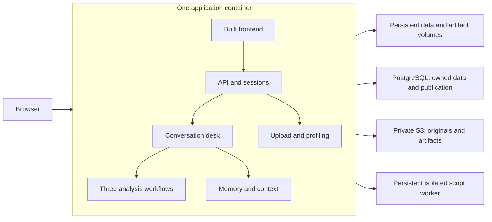

# Private user workspaces and production organization

This is the consolidated entry point for the cleanup and production work, inspected on 22 October 2026. The current application can be packaged before its data model is replaced. Container build/run instructions and verification limits are in [containerization](containerization.md). Hosted authentication, private workspaces, independent worker scaling and complete derived-table lineage remain planned features. Question-first review and consolidated chat are implemented in the current working tree, with acceptance tracked separately.

## The overall decision

Keep one application, organized into modules by responsibility. Build the frontend and backend into one application image. The API serves the built page; desk and family workflows run within that application deployment, including their existing subprocesses. A folder or component does not become a separate service merely because it has a clear owner.



The current Compose deployment includes PostgreSQL and authenticated SeaweedFS for ingestion, profiles, organized context and conversation-owned exploration publication. The app keeps its A2A exploration agent running and submits generated scripts to a small network-disabled Docker worker. Reviewed context, transcripts, selections and operation receipts now live in PostgreSQL. SQLite retains execution checkpoints, and local volumes retain immutable analysis snapshots and runtime files. See [exploration](../exploration.md) and its [acceptance record](../acceptance/whole-dataset-exploration.md) for the implemented boundary and verification; the older packaging baseline is historical. Profiling, memory, desk and each family remain application modules.

## One plan, with detail by concern

| Concern | Decision | Authoritative detail |
|---|---|---|
| What exists now | Current component responsibilities and code evidence | [Component handbook](../components/README.md) |
| How to package now | One app image, persistent volumes, local access, explicit sandbox limits | [Containerization](containerization.md) |
| How to organize code | Frontend features and backend responsibility modules | Sections below |
| Complete application data model | User, datasets, context, chats, reasoning, designs, ledgers, execution, results and artifact ownership | [Consolidated data model](data-model.md) |
| Where LangSmith fits | External execution telemetry and attachments, owned trace links, separate retention and cleanup | [Tracing and storage](tracing.md) |
| Where chat history and ledgers belong | User → datasets and chats; chat → messages, journal, analyses and artifacts | [Hierarchy and current storage map](hierarchy.md) |
| How uploads enter the app | Validate → immutable CSV version → profile → review → conversation | Ingestion section below |
| How edits retain history | New versions, stable identities, measured changes, explicit selection | [Lineage](lineage.md) |
| How to implement without duplicate paths | Chat-centered relations, paired writes/reads, retirement map, blockers and complete vertical slices | [Implementation plan](implementation-plan.md) |
| How to establish correctness | Component tests, real storage, browser journeys, real model runs | [Verification](verification.md) |

Bring-your-own-key remains excluded. Containerization is an early packaging milestone; it does not claim the planned user ownership, database model or production release gates are implemented.

[CSV transformation lineage](lineage.md) specifies how edits create new versions, preserve row and column identity, record measured changes and trigger review of affected causal context.

Follow the [implementation plan](implementation-plan.md) for the complete sequence and the [component verification plan](verification.md) for test ownership, integrated journeys and release gates.

## Product decisions

- One person has one application user identity. A user can own many datasets and conversations. Sharing and organization roles are outside the first release.
- Each uploaded CSV, saved profile, context source, conversation and generated file has one owner. Identical filenames belonging to different people remain independent.
- Provide a dataset and context review page before conversation, and a separate review of the exact context before analysis authorization.
- Implement a development identity provider behind the authentication interface. Enforce ownership immediately. A real login provider is a release requirement for deployment accessible to multiple people.
- Bring-your-own-key is out of scope. Keep model access configured by the operator. Do not add credential tables, provider settings screens or provider switching in this increment.
- Preserve the three analysis families, their causal contracts, confirmation rules and trace entry points.

Authentication establishes who is making a request. Authorization determines whether that person can access a resource. Analysis authorization is a third, separate action: the person permits an analysis of a specific context snapshot.

## What must change in the current implementation

| Implemented owner | Current behavior |
|---|---|
| `server/ingestion` | Owned immutable originals, PostgreSQL and private S3 |
| `server/context` | Mapped extraction, canonical reviewed revisions and review sessions |
| `server/conversations` | Owned commands, messages, selection pins, publication and recovery |
| `memory/context` | Pure edits, catalogue bindings and sealed snapshot reader |
| `web/src/pages` | Dataset details, question-first review and consolidated chat |

See the [current storage inventory](../components/09-persistence.md). Hosted identity, complete derived-table lineage and independent worker scaling remain proposals. The suggested folder organization below is not a requirement to split services.

## Frontend organization

Proposed source tree, created incrementally when an implementation needs each file:

```text
web/src/
  app/                         Routes, shell, application setup
  features/
    account/                   Current identity, sign-in state, sign-out
    datasets/                  Private library, details, versions, deletion
    intake/                    Upload, progress, validation and retry
    review/                    CSV profile, source notes and context review
    conversation/              Messages, questions, activity and resume
    results/                   Designs, estimates, figures and artifact viewers
  shared/
    ui/                        Reused buttons, panels and dialogs
    lib/                       Small shared formatting and display helpers
  api/                         HTTP transport and error handling
  generated/                   Backend-generated API types
```

Each feature owns its components, hooks, API operations and nearby tests. Route components assemble features. Shared UI contains presentation only; readiness and ownership decisions are backend responsibilities. Feature-specific state stays with its feature. Account changes clear cached API data and conversation views before another identity is displayed.

Proposed routes are `/datasets`, `/datasets/new`, `/datasets/:datasetId/review`, `/datasets/:datasetId`, `/conversations/:conversationId` and `/conversations/:conversationId/review`. A conversation's dataset version is displayed explicitly. Retire replaced routes in the same change, following the repository's no-alias rule.

## Backend organization

Keep `causal_agent/` and its existing causal packages. Introduce narrowly owned application concerns:

```text
causal_agent/
  server/                      HTTP routes, API schemas, response projections
    routers/                   Identity, uploads, datasets, conversations, runs, files
  identity/                    Principal and ownership policy
  datasets/                    Upload, registration, versions, review, deletion
  runtime/                     Conversation execution, jobs, checkpoint integration
  storage/                     Database and file-store implementations
  profile/                     Deterministic CSV facts
  memory/                      Sourced knowledge and permitted updates
  desk/                        Interview, context assembly and analysis authorization
  lane/                        Shared workflow execution, tools and gates
  families/                    Adjustment, difference in differences, discontinuity
  explore/                     Restricted exploration and transformation
  viz/                         Shared figure contracts and helpers
  common/                      Small shared contracts, configuration, model and trace access
```

These are modules within one application, not a service per folder. `runtime` means the code that starts work, records progress, saves checkpoints and resumes interrupted work. `storage` saves and retrieves records; it does not decide whether a claim is confirmed or an analysis is ready.

The active chat persistence operations now live in `server/context` and `server/conversations`. Keep `server/models.py` authoritative for API responses and regenerate frontend types whenever it changes. Database entities, causal contracts and API response schemas have different responsibilities; do not use database rows directly as public responses.

Dependency rules for the proposed packages:

1. HTTP handlers authenticate, validate, call an application operation and project its result.
2. Dataset operations can call profiling and memory seeding. Runtime operations can call desk execution. Neither should depend on HTTP or React.
3. Domain operations receive storage interfaces. Concrete database/file implementations are assembled at server or worker startup; memory and profiling must not import the server to find storage.
4. Put only genuinely shared interface types in `common`; keep operation-specific contracts with their owner. Storage implementations may consume those contracts but must not call orchestration to implement persistence.
5. Preserve family entry through the registry and existing rules separating reasoning from effect fitting. Add explicit import-linter contracts for new packages before moving code.
6. All model calls and traced artifact writes continue through the existing trace/model entry points. No model or credential feature is needed for this reorganization.

## Identity and private context

The authentication interface returns a `Principal` containing the internal user ID and authentication method. Development mode supplies one fixed local user, never a user ID chosen by the browser. Production startup rejects development authentication. The real provider maps a validated issuer and subject to an internal user; email and display name are not ownership keys.

Every operation takes the principal or a trusted job scope. Database lookups include owner ID, including downloads, polling, resume, transformations and deletion. An inaccessible resource returns the same not-found response as a nonexistent one. File paths and unguessable IDs are not access control. See the [ownership constraints](data-model.md#ownership-and-consistency-rules).

Keep four context scopes:

| Scope | Contents | Admission rule |
|---|---|---|
| User | Identity and display preferences | Does not automatically enter a model prompt |
| Dataset version | Exact table, profile and version-specific data facts | Loaded through an owned dataset/version reference |
| Dataset knowledge | Sourced claims, statuses, reasons and revisions | Existing memory gates control promotion and updates |
| Conversation and analysis | Question, messages, selected sources, pinned versions and authorized snapshot | Desk selects relevant context; analysis receives the fixed admitted snapshot |

Conversations never retrieve another user's messages. A new conversation may deliberately reuse knowledge for the same dataset, but it does not inherit unrelated chat history. Existing conversations pin a memory revision; another conversation's update requires explicit refresh/review before it changes their context. Shared-memory changes use revision checks to prevent one conversation silently overwriting another.

No vector database or automatic whole-account retrieval is required for this first version. Retain source sentences and citations when assembling the small, relevant context a model call needs.

## Ingestion and the review page

1. Resolve the user identity. Create an owned upload record with an expiry and request idempotency key (a token that makes an accidental repeated request return the original operation).
2. Stream the file into private staging with a byte limit and compute its checksum. Validate CSV parsing, encoding, headers, duplicate/ambiguous column names and resource limits. Retain the original bytes unchanged. Return actionable errors.
3. Create a dataset and immutable version in `processing` state. A failed attempt remains identifiable and retryable. Registration must not start a model conversation as a side effect.
4. Compute the deterministic profile for those bytes and options. Publish its record and set the dataset version to `review_required`. Upload and profiling do not require a model call.
5. Show the review page: filename, version, rows, columns, data preview, missingness, inferred types and quality issues. Display user notes and sourced context separately from computed facts. Permit replacing the file, retrying profiling or adding a sourced study account.
6. Save review acceptance against the exact version, profile and selected context revision. Acceptance acknowledges the review; it does not confirm every extracted claim or authorize causal analysis.
7. Explicitly start a conversation linked to that reviewed version. The desk asks the causal question and clarifies or confirms study context using its existing rules.
8. Before analysis, the conversation review shows the question, table version, confirmed and unresolved context, assumptions, family and endpoint admission. A run instruction authorizes that exact snapshot.

First-release source context is pasted study text with an optional source URL/reference and an immutable stored copy. Do not fetch arbitrary URLs or add document parsing implicitly. Extracted claims remain drafts. A new source revision, table version or material context correction makes the previous review stale and requires another review where relevant; an old review can still be displayed as history.

One CSV version has a saved profile for each profiler version and option set. A transformation creates a new dataset version and a new profile before review. It never overwrites the uploaded CSV or applies an old profile to changed bytes.

## API boundaries to implement

Proposed paths, not currently implemented endpoints. Every row except identity discovery requires the resolved user and checks resource ownership.

| Operation | Request and result | Enforcement and failure |
|---|---|---|
| `GET /api/me` | Current authenticated identity | No arbitrary user selection |
| `POST /api/uploads` | Multipart CSV → upload ID and state | Intake enforces streaming size limit and validation; invalid/oversize requests fail explicitly |
| `POST /api/datasets` | Upload ID and title → dataset/version IDs | Upload owner, expiry and consumption checked; repeat request returns original registration |
| `GET /api/datasets/{id}/versions/{versionId}/review` | Owned version → profile, sources, issues and review status | Dataset/version relationship and profile identity checked |
| `POST /api/datasets/{id}/sources` | Study text and optional reference → immutable source revision | Owner checked; text remains sourced input, not automatic confirmation |
| `POST /api/datasets/{id}/reviews` | Version, profile, context revision and acceptance → review ID | Stale revisions produce a conflict; no analysis starts |
| `POST /api/conversations` | Dataset/version and review IDs → conversation ID | All references have same owner and dataset; reviewed identity must match |
| `POST /api/conversations/{id}/messages` | Text and client message ID → turn/job state | Deduplicate submission and enforce one active turn; memory writes remain gated |
| `GET /api/conversations/{id}/review` | Current question/context → immutable review candidate and deficiencies | Desk owns readiness; candidate changes invalidate prior run permission |
| `POST /api/conversations/{id}/analyses` | Snapshot ID and explicit run instruction → analysis request/job ID | Fresh admission and matching snapshot checked; execution cannot expand authorized context |
| `GET /api/files/{id}` | File ID → permitted download | Owner, parent visibility and published state checked; never accept a raw filesystem path |
| `DELETE /api/datasets/{id}` | Dataset ID → deletion operation state | Hide immediately, coordinate active work, retry physical cleanup |

Specify exact API fields in Pydantic during implementation. Use consistent error codes for invalid input, not found, stale revision, busy, quota exceeded and dependency failure. Persistent progress supports reconnecting without repeating creation or analysis.

## Storage and deployment

Proposed production target: PostgreSQL for ownership, relationships, statuses, messages and knowledge revisions; a private file store for CSVs, profiles, context snapshots and artifacts. Begin with a backed-up mounted directory on one host. Keep file-store operations behind an interface so object storage can be introduced when needed. The [data model](data-model.md#file-strategy) defines keys and publication rules.

Use one application image containing the built frontend and backend. Retain analysis subprocesses initially; introduce a separately scaled worker only after durable job ownership/recovery is implemented. PostgreSQL is a separate service or managed database. Generated scripts run in restricted sandbox containers. They receive only the permitted input and a job output directory, with no database/model credentials, user-root mount or Docker socket. The trusted sandbox launcher needs its own deployment design; do not expose Docker administration to generated code or the public API.

Application code is immutable in deployment. Durable files, database storage and temporary work directories have separate lifetimes. Secrets remain deployment configuration. Docker documents [production Compose configuration](https://docs.docker.com/compose/how-tos/production/) and [persistent volumes](https://docs.docker.com/engine/storage/volumes/); neither replaces application ownership checks or backup verification.

## Implementation sequence and release evidence

The [implementation plan](implementation-plan.md) is authoritative for phase numbering, cross-layer deliverables, prerequisites and exit criteria. Work proceeds through baseline/contracts, identity/storage, owned ingestion/review, conversations/context, modifications/lineage, analysis/results, file lifecycle and deployment. Each phase includes frontend, backend, contracts, data and the tests assigned in the [verification matrix](verification.md#component-responsibility-matrix).

Run the repository's required lint, import, type, API generation, frontend and test checks for the affected implementation. Changes to desk behavior, judgments or gates also require real Gemini execution and trace inspection under [AGENTS.md](../../AGENTS.md). No model runs are required for this design document. Define expected load, maximum file size, retention, acceptable data loss and recovery time before claiming production readiness; numeric budgets are not established by this plan.

Follow the repository's fresh-start policy: do not add old-layout readers, aliases or checkpoint migration. Preserve fixture datasets and claims under `data/`. A future cutover must inventory disposable runtime files and explicitly select the cleanup scope; this plan performs no deletion. Retiring schemas and files is a controlled implementation step, not permission to erase arbitrary user uploads.

## Current completion state

The design documents and baseline container setup are present. See the container guide for checks actually performed and unresolved runtime limits. Authentication, ownership, database tables and new review routes remain implementation work. The login provider, hosting platform and operational budgets are still to be selected. Existing uncommitted application work is not reorganized by this proposal.

## Phase 4 context increment

[Organized context](../components/phase4-context.md) adds PostgreSQL semantic statements and the column viewer to the existing app. It does not introduce another service or connect the new records to conversational memory. The future proposals above are not descriptions of this implemented storage path. See its [verification record](../audits/phase4-context.md).
