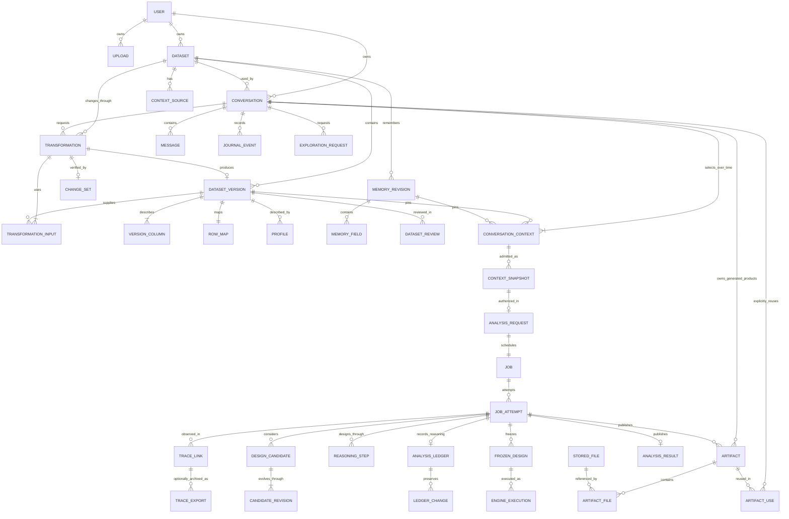

# Consolidated application data model

Status: design for [private user workspaces](README.md), not a description of current database tables. Bring-your-own-key is excluded. Existing causal schemas remain authoritative for statistical and evidence fields.

Start with the [ownership hierarchy and current storage map](hierarchy.md) to distinguish user, dataset, chat, analysis, journal, knowledge and evidence ledger.

Implement these relationships using the [chat identity, paired read/write paths and retirement plan](implementation-plan.md#chat-identity-is-the-connection-point). That plan owns the implementation sequence and blocker reporting; this document owns the record definitions.

CSV edits are first-class operations. See [version and transformation lineage](lineage.md) for row/column identities, change records, review, branching and effects on causal context.

## Scope and organizing principle

One user owns datasets and conversations. A conversation selects one dataset in the first release. Dataset versions, profiles and sourced knowledge can be reused within that user's account. Messages, context selections, reasoning, analyses, journals and generated products have explicit conversation provenance. No organization, collaboration or bring-your-own-key model is included.

There are seven responsibility groups, all within one application: identity; datasets and lineage; knowledge and context; conversations; analysis design; execution; artifacts and storage. These groups are not separate services or a container plan. PostgreSQL holds relationships and transactional records; a private durable file store holds immutable payloads. The current Docker baseline still uses the existing files/SQLite until these adapters are implemented.

This is the canonical logical model. The hierarchy document explains it; the lineage document specializes it. Record names below identify distinct responsibilities, not a requirement for a separate SQL table for every typed payload. Ownership, searchable identities, ordering, status and foreign keys belong in relational columns. Family-specific details and bounded episode logs may be schema-validated JSON. Final DDL must implement the specified invariants.

## Identity and relationships

Use generated UUIDs for persistent identity. Titles, filenames and slugs are display attributes. Renaming a dataset must not relocate its files or change its conversations. One internal user represents one person; the login integration binds a verified provider issuer/subject to that identity. Initially a single local development identity can use the same model.



The diagram shows principal relationships, not every foreign key. A job can also perform profiling, a desk turn, exploration or transformation without an analysis request. An authorized analysis request has one execution job and can produce several candidate/frozen designs. A permitted retry is a new attempt of that job, not permission to change the question or input context. Pending records may have incomplete output children; publication rules below define when they become usable.

## Records and owners

Every owned record includes `owner_id`, a generated ID and UTC timestamps unless it is a child with a composite identity. References between owned records must preserve ownership, not merely point to any existing row.

### Identity and uploaded data

| Record | Essential fields and relationships | Functional owner |
|---|---|---|
| User | `id`, unique verified auth issuer/subject, display name, active status | Identity |
| Upload | owner, original filename, staged file ID, bytes, SHA256, state, expiry, idempotency key | Intake |
| Dataset | owner, title, originating upload ID, state, default version ID, latest knowledge revision pointer | Dataset lifecycle |
| DatasetVersion | dataset, version number, parent version ID, producing transformation ID (null for upload), producing attempt, table file ID, checksum, parsing options, row-map file ID, schema hash, state | Dataset lifecycle; exploration proposes transformations |
| Transformation | dataset, requesting conversation/message/user and context revision, intent, ordered operations or script, parameters, execution job, accepted producing attempt, input/output hashes, validation and review state | Transformation operation |
| TransformationInput | transformation, input version ID, role and pinned checksum; exactly one table input in the first release | Transformation operation |
| ChangeSet | transformation/output version, measured row/column/cell changes, detailed diff file, context-impact flags, verification scope | Deterministic transformation validator |
| TransformationReview | transformation, candidate version, change-set hash, profile, accept/reject decision, acting user/message/time, reason | Dataset review |
| VersionColumn | version, stable column ID, display name/order/type, source column IDs and operation reference | Dataset schema/lineage |
| RowMap | version and immutable file mapping output positions to stable source-row IDs; schema, checksum and counts | Dataset row identity |
| Profile | dataset/version, table checksum, profiler version, normalized options hash, profile file ID, status | Profiling |

Upload V0 has no parent or producing transformation. Its CSV uses the exact uploaded bytes, with a durable `StoredFile` reference established before staging expires. A transformation publishes at most one candidate version in this first release; retries cannot replace its bytes. Failed execution products remain attempt diagnostics. A revised instruction creates a new transformation. Joins, aggregation and multiple-input lineage are deferred as specified in [lineage](lineage.md).

Authentication identifies a principal mapped to `User.id`; authorization uses that ID for every owned lookup. A local development identity is an adapter to this same contract. Hosted login/session validation uses the selected authentication provider; graph checkpoints are never authentication sessions. Provider credentials and session tokens do not belong in dataset, message or artifact records.

### Knowledge, review and context

| Record | Essential fields and relationships | Functional owner |
|---|---|---|
| ContextSource | dataset, immutable text/file reference, source label/URL, submitting user, optional originating message and superseded source ID | Intake/context collection |
| DatasetReview | dataset/version, profile ID, selected source manifest/hash, memory revision if present, accepted by/at | Review operation |
| MemoryRevision | dataset, revision number, parent revision, table-version applicability, author/rule, reason | Memory |
| MemoryField | memory revision and address, value, status, source sentence, reason, evidence and typed source references | Memory |
| ConversationContext | conversation, selection revision, previous selection ID, dataset version, profile, memory revision, selected source IDs, dataset review, selecting user/message/event and time | Conversation context selection |
| ContextSnapshot | conversation/context selection, exact question and requested target, dataset/version/checksum, profile, memory revision, included sources, family, admissions, handoff file/hash, contract fingerprint | Desk/handoff |

`ConversationContext` records what the chat is currently working with; a new selection creates a new record. `ContextSnapshot` records the exact input admitted for a particular proposed analysis. It is immutable and narrower than the chat's entire history. Authorization of that snapshot is recorded by `AnalysisRequest`, not inferred from a dataset review or a message containing an arbitrary word.

Dataset memory is reusable sourced knowledge. Model assumptions, hypothetical alternatives and analysis ledger entries do not automatically enter it. The latest dataset knowledge pointer does not override a chat's selected revision. Revisions declare their table applicability; selecting another version requires an applicable revision, not the highest revision number. Evidence originating in a chat keeps its source message identity and retained source text.

### Conversations and requests

| Record | Essential fields and relationships | Functional owner |
|---|---|---|
| Conversation | dataset, current context selection ID, title/question, stage, checkpoint thread ID, concurrency revision | Conversation runtime |
| Message | conversation, unique sequence and client submission ID, role, typed content, author, reply/request/job references and scoped citations | Conversation runtime |
| DeskDecision | conversation and desk-turn attempt, step/visit, input message and context selection, decision kind, typed framing/routing/readiness/admission record, evidence, validation outcome and optional episode log | Conversation desk |
| JournalEvent | dataset, primary scope (dataset or conversation), conversation when scoped to it, unique scope sequence, event kind, actor, causative message/job, affected record references, before/after revision IDs and time | Operation producing the event |
| ExplorationRequest | conversation/message, selected context, task, permitted data projection and analysis phase, optional referenced analysis result, budget, execution job, status | Exploration |
| ExplorationResult | request/producing attempt, completed/declined/failed outcome, validated summary and scoped fact references, artifact IDs, validation errors and result schema version | Exploration result gate |
| AnalysisRequest | snapshot, authorizing message/user/time, family, request identity and state | Desk authorization |

Transformations are another conversation request type, defined in the data group because they produce dataset versions. Exploration can happen before or after an analysis. Its request records the permitted view of the table, including protected-column restrictions, instead of relying on the dataset's latest state when a worker eventually starts. Accepted user messages are durably saved before work is scheduled; duplicate client submission IDs return the existing submission.

`DeskDecision` preserves structured reasoning before an analysis exists: how the question was framed, which context is missing, and why a family or handoff was proposed. `ReasoningStep` below preserves specialist design reasoning after admission. Neither is inferred by reparsing assistant prose. `ExplorationResult` is a typed immutable payload attached to its attempt, not a second artifact shelf; it refers to the generated products and can record a decline with no files.

`JournalEvent` records actions and links to durable objects. It does not duplicate every message, ledger change or result payload. Conversation events form the activity history. Dataset-only events cover upload, profiling or deletion before any chat exists. Message edits/corrections are new messages with explicit references; causal knowledge changes still require the memory gate.

### Execution and recovery

| Record | Essential fields and relationships | Functional owner |
|---|---|---|
| Job | owner, kind, dataset/version, conversation where applicable, typed cause reference, request key, status, lease token/expiry, attempt limit | Runtime |
| JobAttempt | job, attempt number, start/end, lease token, error classification, application/contract/engine versions, environment or image digest, model configuration without secrets, related trace links, published manifest | Runtime |
| EngineExecution | analysis attempt, frozen design, target/contrast, declared method or permitted fallback, input/specification hashes, seed if relevant, start/end, status/error, output references | Family execution adapter |
| TraceLink | owner and typed application scope, provider endpoint/workspace/project, trace/root and run/span IDs, thread ID, job attempt (or pre-job upload scope), optional linked step/execution/artifact, timestamps and observed delivery/availability state | Tracing adapter |
| TraceExport | owned trace scope/link, stored file/hash, export format/version/time, included spans/attachment manifest, completeness and retention/deletion state | Optional telemetry archive |

A job's kind determines exactly one cause: upload/profile work, a desk-turn message, an exploration request, a transformation or an analysis request. Use typed foreign keys and kind/nullability constraints rather than an unchecked generic string ID. Request and job creation form one database transaction. A separate message queue is not required for the first database-backed worker; if one is later added, dispatch must be recoverable from committed jobs.

A job attempt is an application execution attempt. An engine execution is one statistical calculation inside an analysis attempt. A bounded model episode is one reasoning task within a step. These three levels must not share an ambiguous `attempt_id`. Worker recovery must follow the existing lane policy: a crashed lane is not silently resumed or rerun with new model calls merely because job retries exist.

LangSmith stores remote execution telemetry and can hold copies of traced files. The application's structured reasoning, journals, results and checkpoints remain authoritative in their own stores. `TraceLink` connects those records to provider spans; one chat can have many trace roots. `TraceExport` is optional and must state whether attachment bytes are included. Remote retention/access/deletion are independent from local storage. See [LangSmith tracing and storage](tracing.md) for current code, payload limits, configuration evidence and the missing lifecycle integration.

### Analysis reasoning, design and results

| Record | Essential fields and relationships | Functional owner |
|---|---|---|
| ReasoningStep | producing attempt, ordered step/visit ID, stage, input/evidence references, typed decision, explanation, gate outcome, linked episode log, ledger revision and candidate references | Family reasoning through shared runtime |
| DesignCandidate | producing attempt, stable candidate identity, current revision and status; resulting frozen designs resolved through their source candidate revision | Family design reasoning |
| CandidateRevision | candidate, revision, preceding revision, producing reasoning step, immutable full candidate specification, status, support/eligibility checks, selection/rejection reason and evidence | Family design reasoning |
| AnalysisLedger | analysis request, producing attempt, current accepted revision, published result revision; one ledger per analysis attempt | Shared analysis runtime and family workflow |
| LedgerChange | ledger, unique revision, entry ID, typed before/after entry, evidence references, producing reasoning step, actor/rung, reason and time | Ledger gate; storage persists accepted changes |
| FrozenDesign | analysis request, producing attempt, source candidate revision, freezing reasoning step, ledger revision, family design key, specification file and integrity seal | Family workflow |
| AnalysisResult | analysis request/attempt, terminal outcome, immutable result payload/file and schema version, context snapshot, published ledger revision, frozen designs, engine executions, lead-selection record, artifact references | Family result assembly |

An attempt has zero or one published result envelope; several designs and executions may appear inside it. Deficiency, decline, infeasibility and execution failure are valid recorded outcomes, not fabricated estimates. An attempt that crashes before assembly may have only its failure record and no result. Estimates, uncertainty, checks, sensitivity, comparisons and interpretations remain typed fields in the result payload, not one loosely typed database entity per scalar. UI summaries are projections of that payload.

The audit path is explicit:

```text
AnalysisRequest → ContextSnapshot → exact table, profile, knowledge and selected sources
  Job → JobAttempt
    ReasoningStep → structured episode evidence/answer/checks
    DesignCandidate → CandidateRevision → proposing/checking ReasoningStep
    AnalysisLedger → LedgerChange → evidence and producing ReasoningStep
    FrozenDesign → source CandidateRevision + freezing step + ledger revision
    EngineExecution → FrozenDesign + exact inputs + permitted estimator
    AnalysisResult → executions + designs + final ledger revision
    Artifact → producing step/execution/result + files
```

Steps can read an existing ledger revision and propose new changes. Each accepted change points to its producing step; each step records its input and output revision numbers. Allocate the step, then commit its accepted changes and output references atomically. This avoids a circular creation dependency while retaining both directions for inspection.

### Artifacts, files and lifecycle

| Record | Essential fields and relationships | Functional owner |
|---|---|---|
| Artifact | dataset/version, selected knowledge/context, producing attempt, originating conversation, optional request/design/result/step/execution, kind, immutable manifest and citation namespace, publication state | Producing component; storage handles publication |
| ArtifactFile | artifact, file, role (figure/table/report/script/facts), display order; unique artifact/role/name | Artifact publication |
| ArtifactUse | consuming conversation and message/context, original artifact, user selection/time and permitted use | Explicit reuse within the same user's dataset |
| StoredFile | owner, dataset where applicable, generated storage key, kind, media type, byte size, checksum, publication state | File storage |
| DeletionOperation | owner, scope (dataset or account), target ID, state, remaining file/job/checkpoint/export references and external trace-cleanup tasks, failure/retry details | Dataset/account lifecycle |

Every published artifact has registered files or a validated inline structured payload, such as a figure specification. A picture and the facts behind it are linked parts of one artifact, not unrelated files discovered by folder scanning. `ArtifactFile` allows a file to be referenced without assuming every stored file is an artifact: source CSVs, profiles, snapshots and design specifications have their own owning records. Physical copies must not become competing mutable records. Dataset ownership alone does not admit every artifact into every chat.

Each file is registered to its owning resource before publication. Foreign keys establish permitted references; deletion checks all live references before removing bytes. The first release exposes whole-dataset deletion, with account deletion orchestrating the same cleanup for all owned resources. Standalone chat deletion and arbitrary version pruning stay deferred until source-retention and cross-chat reuse policies are implemented. Hiding or archiving a chat must not be mislabeled as erasing its data.

Framework checkpoints use their supported persistence schema in a separate database namespace. Register ownership of each thread through the conversation record. Checkpoints describe execution progress; they do not replace messages, dataset knowledge or the authorized context snapshot.

The entity tables describe relationships, including reverse lookups. They do not require reciprocal foreign keys on both rows. For example, the job holds its analysis-request foreign key; the request's job is found through that unique relation. Likewise the frozen design points to its candidate revision. Current pointers such as `Conversation.current_context_id` are conveniences maintained transactionally and constrained to that parent's children.

Store ownership, relationships, sequence numbers and states as constrained columns. Use schema-validated JSON payloads for family-specific specifications, admissions, results and field values. Do not duplicate the exhaustive causal definitions here: see [memory records](../../causal_agent/memory/records.py), [handoff contracts](../../causal_agent/common/contracts/pack.py), [frozen designs](../../causal_agent/common/contracts/frozen.py) and the [three family chapters](../components/README.md).

Ledger payloads retain [Entry, Evidence and Change](../../causal_agent/lane/ledger.py) semantics. A ledger records accepted evidence/decision changes, not the chat transcript or private model reasoning. Current ledger entries are a projection of ordered changes, optionally materialized transactionally. Journal events link ledger updates and artifacts to the chat without duplicating their entire contents. Conversation-bound references must preserve conversation identity as well as owner and dataset identity.

Design reasoning is broader than ledger updates. `ReasoningStep` and candidate revisions preserve how the analysis specification was developed, including alternatives and stops before a frozen design exists. Keep step sequence/visit and candidate revision unique within their parents. The current `reasoning_history`, `candidate_history` and `episodes` provide source material, but their family-specific dictionaries require explicit adapters and validated schemas during implementation. A rejected decision can be recorded as a failed reasoning step without becoming an accepted ledger update or frozen design. Large episode logs may be immutable file payloads referenced by their database records. See [where the analysis is designed](hierarchy.md#where-the-analysis-is-designed).

## Ownership and consistency rules

1. Every resource lookup includes the authenticated owner. Jobs obtain their owner from a stored, authorized job record, not from an arbitrary caller parameter.
2. Add unique `(owner_id, id)` keys and composite foreign keys for owned references. Use dataset-qualified references where needed so a conversation cannot link a version or profile from another dataset owned by the same user. PostgreSQL supports [foreign-key and uniqueness constraints](https://www.postgresql.org/docs/current/ddl-constraints.html); application checks should explain failures before a database constraint rejects them.
3. Enforce uniqueness of `(dataset_id, version_number)`, `(dataset_id, memory_revision_number)`, `(conversation_id, message_sequence)`, `(conversation_id, context_revision)`, `(event_scope, scope_id, event_sequence)`, `(attempt_id, step_sequence)`, `(candidate_id, revision)`, `(ledger_id, revision)` and `(job_id, attempt_number)`. Allocate counters transactionally, not by listing directories and taking the largest number.
4. A usable profile identifies exact CSV bytes, parsing/profile options and profiler version. Enforce one profile record per `(owner_id, dataset_version_id, profiler_version, options_hash)`. Cache reuse is owner-scoped; filenames alone never select profiles. Different profiling options can legitimately produce different profiles for the same version.
5. Memory updates retain the existing source/status rules. In a transaction, compare the expected current revision, insert the new revision and fields, append the journal event, then move the dataset's current pointer. If the initiating chat adopts that revision, create its new context selection and move its pointer in the same transaction. Concurrent stale updates fail with a revision conflict. Other conversations do not silently change their pinned revision.
6. Version switches and context refreshes require the person's action and a new review when they affect admitted context. Frozen snapshots, designs and published result files are immutable until explicit lifecycle deletion.
7. One active turn/job may mutate a conversation at a time. Dataset-level memory writes are also revision checked across conversations. The worker's lease token prevents an expired worker from publishing over a replacement worker.
8. An authorized snapshot, analysis request and queued job are committed together. Jobs use at-least-once recovery: duplicate delivery must not publish duplicate messages/results. Model calls already made before a crash may have cost money; do not claim exactly-once external calls.
9. Transient transport retries preserve the same inputs, identifiers and budget. A process failure requiring a new analysis under the current lane policy stays a visible failure. Changed data, context, family or design requires fresh admission and authorization; infrastructure recovery cannot bypass that rule.
10. Dataset deletion makes the dataset unavailable, blocks new work, invalidates active publication leases, and records cleanup work. Purge files, checkpoints and dependent records through a retryable operation. Late workers must not resurrect a deleted dataset. Future standalone conversation deletion must preserve its user's dataset and unrelated conversations; references from memory and artifact reuse need an explicit retention or redaction policy before that feature ships.
11. Development identity is accepted only in explicit local mode. Real sessions require authenticated expiry/logout handling. Cookie-based login requires CSRF protection for mutations; API and file endpoints share the same access checks.
12. Ledger revisions are unique within a ledger; entry addresses are scoped to that ledger, never global across chats. Persist an accepted update batch and advance its revision atomically using expected-revision and attempt-lease checks. Replaying an already committed batch must not append duplicate changes. Rejected gate proposals are attempt diagnostics. Published results pin an immutable ledger revision.
13. Chat-generated artifacts must reference their originating conversation and attempt. Analysis artifacts additionally reference the analysis request; exploration artifacts may exist before an analysis. Reusing a product in another chat requires an explicit reference and preserves the original provenance. Shared profiles and source documents are separately typed dataset records, not artifacts with an invented chat owner.
14. Candidate revisions, ledger changes, frozen designs, engine executions and results must resolve to the same analysis attempt. A step may cite prior results only through explicit, authorized evidence references. An artifact's producing conversation must match its producing job. Matching user IDs alone is insufficient.
15. Dataset review, transformation review and run authorization are separate decisions. A reviewed version does not authorize a causal run. A new context selection invalidates an unconsumed authorization proposal for the old selection; completed analyses remain valid records of their original context.
16. Preserve unique client-request keys within their operation scope. Reusing a key with different input returns a conflict. Enforce one analysis job per analysis request, one published result per analysis attempt and one checkpoint-thread owner. No user-provided filename, dataset title or citation address is a primary key.

## Evidence and citation references

An address such as `claim:...`, `probe:...`, `estimate:...` or `figure:...` is meaningful only within its source scope. Store an evidence reference as a typed scope (memory revision, authorized snapshot, reasoning episode, analysis result or artifact), scope ID, address and schema version. Messages also retain the source result/artifact IDs for displayed citations. A raw address must never resolve against whichever run happens to be latest.

Use actual foreign keys for record-level links. For addresses within JSON/file payloads, the owning component validates the address against the immutable scoped payload before acceptance/publication. Persisted source IDs and payload hashes make that resolution reproducible. Do not claim a generic `(target_type, target_id)` string pair has database referential integrity without typed reference columns or explicit validation. Citation validation does not grant access to another user's resource.

## Lifecycle and authoritative state

| Record | Proposed application lifecycle | Publication/transition rule |
|---|---|---|
| Upload | staged → registered, or failed/expired | Original bytes become a durable version before staging cleanup |
| DatasetVersion | pending → candidate or ready; failed/deleting as needed | Validated candidate can be reviewed; only reviewed selection enters a chat context |
| Profile | pending → running → ready/failed | Ready identifies exact table bytes, options and profiler version |
| Conversation | active → ended/archived | Busy, waiting and error indicators derive from its current job/checkpoint; archive is not deletion |
| Job | queued → running → succeeded/failed/cancelled | Retry creates a new attempt only when permitted; terminal attempt history remains |
| ReasoningStep | pending → accepted/rejected/stopped/failed | Preserve the outcome even if no candidate or design follows |
| CandidateRevision | family-specific proposed/eligible/declined/selected state | Immutable revision; family adapter validates its transition and schema |
| AnalysisRequest | authorized → queued → running → completed/failed/cancelled | Completed means a published terminal result, which can be a decline or deficiency |
| Artifact/StoredFile | pending → ready → deleting/deleted; failed publication retained | Private incomplete bytes cannot be served as ready outputs |
| DeletionOperation | requested → running → complete, with retryable failure | Hide targets first; finish reference/file/checkpoint cleanup before complete |

These are proposed application states; exact API enums must be declared once in server contracts. Family causal outcomes retain their own typed vocabulary. Job state answers whether execution finished; result outcome answers what the study supported. Dataset processing progress and chat inspector summaries are views over authoritative records, not additional writable status stores.

| Question or UI view | Source of truth |
|---|---|
| My datasets and chats | Owner-scoped Dataset and Conversation records |
| What this chat knows now | Current ConversationContext plus its exact knowledge revision and source selection |
| What was said / what happened | Message / JournalEvent, respectively |
| Why the desk asked or routed this way | DeskDecision plus its source message/context and validation record |
| How the design developed | ReasoningStep, candidate revisions, accepted ledger changes and episode evidence |
| What actually ran | FrozenDesign and EngineExecution, under the recorded JobAttempt |
| What the result says | Immutable AnalysisResult payload and its scoped citations |
| Which pictures and tables appear here | Originating Artifact records plus explicit ArtifactUse records |
| Where to resume | Owned framework checkpoint, with durable job status reconciled on recovery |

Indexes should match these reads: owner and updated time for datasets/chats; conversation and sequence for messages/events; dataset and version/revision for history; attempt and sequence for reasoning; artifact origin/version and explicit use for galleries; job status/lease expiry for recovery. Paginate messages, events and large histories. Do not load an entire user's account into every model turn.

## Transaction boundaries and component access

Use a transaction for each accepted domain operation, including its journal entry and current-pointer updates. PostgreSQL [transactions](https://www.postgresql.org/docs/current/tutorial-transactions.html) provide an all-or-nothing database operation; they do not include local files or external model calls. File publication is specified separately below.

| Operation | Records committed together | Component that authorizes the change |
|---|---|---|
| Register an upload | Dataset, V0, file registration and profile job | Intake |
| Start a chat | Conversation, initial context selection and checkpoint ownership | Conversation runtime after dataset review |
| Submit a turn | Unique Message, desk-turn Job and journal event | Conversation runtime |
| Confirm knowledge | New memory revision/fields, optional new chat selection, journal and pointers | Memory source/status gates |
| Accept a transformation | Exact review, new context selection, applicable memory revision and journal | Dataset review plus memory checks |
| Authorize analysis | Snapshot, AnalysisRequest, Job and journal | Desk admission and person's authorization |
| Accept a reasoning step | Decision, candidate revisions, ledger changes and resulting revision references | Family gates through shared runtime |
| Publish a result | Result metadata, artifact/file manifests, attempt/job completion and journal | Runtime lease checks plus family result validation |

Frontend screens use API projections; they do not write storage directly. The API resolves ownership and invokes application operations. Desk, memory and family code retain semantic authority; persistence adapters perform storage mechanics. Workers receive explicit owned scope and immutable input IDs. No component chooses a user by mutating global paths, and family statistical engines do not query arbitrary chat history. One application image and one database suffice for these boundaries; sandbox isolation is a separate execution concern.

## File strategy

Keep source code and fixtures in the repository. Put runtime files under a configured storage root outside the checkout in production. For a local installation, the following is a proposed layout, not a move already performed:

```text
storage/
  users/<user-id>/
    uploads/<upload-id>/source.csv
    datasets/<dataset-id>/
      versions/<version-id>/
        table.csv
        row-map.csv
        columns.json
      transformations/<transformation-id>/
        request.json
        operations.json
        code.py
        execution.json
        changes.json
        cell-changes.jsonl
      profiles/<profile-id>/profile.json
      sources/<source-id>/source.txt
    conversations/<conversation-id>/
      snapshots/<snapshot-id>/handoff.json
      analyses/<analysis-request-id>/attempts/<attempt-id>/
        result.json
        designs/<design-id>/specification.json
      artifacts/<artifact-id>/
        manifest.json
        facts.json
        figure.png
        table.csv
        code.py

work/<job-id>/<attempt-id>/      Temporary permitted inputs and unpublished outputs
cache/<user-id>/                Recomputable, bounded cache
```

Artifact folders contain only applicable files. Source filenames are metadata, never path segments supplied directly by a user. File-store code generates keys, confines local paths beneath the storage root and prevents symlink/path traversal. Physical user folders make lifecycle work easier; database authorization remains required.

Messages, journal events, knowledge revisions and ledger changes are database records, so they do not need parallel mutable JSONL files under these directories. Analysis JSON files are immutable exports tied to their published revisions. Conversations reference dataset/version IDs even though their file directories are siblings of datasets.

Transformation files are also conditional: structured operations need not generate a script, and a filter with no value changes needs no cell-change payload. File metadata still records each published file, including lineage files. Their owner and publication/deletion rules match the version they describe. A nonempty admitted version has a complete row map and column manifest; a pending/failed version may not yet have them.

Keep CSV as the initial canonical table format so existing engines retain their parsing behavior. Preserve uploaded bytes and parsing options. Do not introduce a Parquet conversion in the ownership refactor. Profiles and analysis snapshots remain JSON files; database records point to them. YAML remains suitable for checked-in family declarations and fixture metadata, not the live application index. Messages and memory revisions are database records; JSONL/Markdown can be generated exports rather than competing mutable stores.

Database and file writes are not one atomic operation. Publish with the following protocol:

1. Reserve owned metadata in a nonpublic `pending` state and allocate immutable file keys.
2. Write files to private storage and verify sizes/checksums. A failed operation records its failure without advertising a ready artifact.
3. In a database transaction, verify resource state and the current job lease, attach the completed manifest and mark records `ready`. Readers serve only ready records with verified file references.
4. Reconcile abandoned pending objects after an expiry. A deletion operation uses the same manifest to finish removal after interruption.

Back up the database and durable files with a recoverable manifest/checkpoint of published objects. Test restoration into an empty installation, including file checksums and a conversation resume. Caches and work directories are excluded from backups. Choose retention and deletion behavior for backups before accepting hosted user data; a successful live deletion does not erase historical backups automatically.

## Example: one CSV, two conversations

A user uploads `sales.csv`. The server creates upload U, dataset D, version V0 and profile P0, all under that user's ID. The review records V0/P0 and source S0. Conversation C1 pins V0 and memory revision M1. Confirmed context creates M2 through the memory gate. C1's analysis authorizes snapshot H1 containing V0/M2 and the selected sources.

A second conversation C2 can deliberately select the same dataset and reuse M2. It has its own messages, question, checkpoint thread and run authorization. If C2 later confirms a correction producing M3, H1 stays unchanged. A new C1 analysis must review updated context rather than silently using M3.

C1's analysis attempt A1 owns ledger L1 and its ordered changes. C2's attempt A2 owns a different ledger L2, even if both contain an entry with the same causal address. A picture requested before either analysis belongs to its originating conversation and exploration attempt. It still records V0 as its input. Journal events connect these activities to the messages that requested them.

A transformation proposes V1 with parent V0, its script and row lineage. P1 describes V1. Reviewing and selecting V1 does not mutate V0/P0 or run an analysis. Another user uploading a file also named `sales.csv` receives independent IDs, storage keys, profiles and conversations.

## Coverage and first-release limits

| User journey | Connected records |
|---|---|
| Upload, inspect and review | User → Upload → Dataset/V0 → Profile → DatasetReview |
| Start and continue a private chat | Conversation → ConversationContext → Message → desk-turn Job/Attempt → DeskDecision → reply and JournalEvent |
| Confirm/correct context | Source Message → MemoryRevision/Fields → new ConversationContext → JournalEvent; older snapshots remain fixed |
| Explore or visualize before analysis | ExplorationRequest → Job/Attempt → ExplorationResult → Artifact/ArtifactFile → StoredFile |
| Change the CSV | Transformation/Input → Job/Attempt → candidate Version/ChangeSet → Profile → TransformationReview → new ConversationContext |
| Design and run analysis | ContextSnapshot → AnalysisRequest → Job/Attempt → ReasoningStep/Candidates/Ledger → FrozenDesign → EngineExecution → AnalysisResult/Artifacts |
| Discuss or cite a result | Message → scoped AnalysisResult/Artifact references; desk decisions and journal retain the follow-up provenance |
| Ask a new question or rerun with changed context | New conversation or newly authorized AnalysisRequest, with fresh snapshot and separate attempt histories |
| Process failure and recovery | Job/Attempt error + owned checkpoint + unchanged request identity; permitted recovery policy decides resume, retry or visible failure |
| Delete a dataset/account | DeletionOperation → inaccessible targets → lease invalidation → reference/file/checkpoint cleanup |

Verification must exercise these links, including incorrect same-user cross-chat references as well as cross-user references. See [verification](verification.md). Hosted authentication-provider choice, backup retention and measured recovery objectives remain deployment decisions. Multi-user sharing, multiple datasets in one chat, unsupported joins/aggregation, standalone chat erasure and arbitrary historical-version pruning are excluded from this first-release model. Exclusion must be reflected in the UI rather than simulated by incomplete deletion or guessed lineage.

## Implementation limits

This is a logical data model. SQL DDL, repository interfaces, supported checkpointer selection and exact API schemas are implementation deliverables, with integration tests against the chosen database. No database has been created or migrated by this document. The existing no-backward-compatibility repository rule still applies; preserve fixtures and separately scope any runtime reset.
