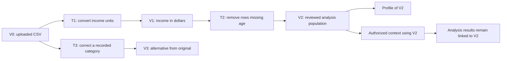

# CSV versions, transformation lineage and context

Status: proposed extension to the [data model](data-model.md). No CSV, transformation behavior or runtime schema is changed by this document.

## The rule

Preserve the uploaded CSV bytes as version 0. A modification creates a new immutable version and a transformation record explaining its derivation. The application may select another version for a conversation, but it never replaces the original file or silently changes an analysis input.

Lineage answers where data came from and what processing produced it. Provenance additionally records who requested the processing, why, when and with which evidence. This follows the separation of data, activities and responsible actors described in [W3C PROV](https://www.w3.org/TR/prov-overview/); it does not require a graph database or an RDF implementation.

Versions can branch. A version number is a display sequence, not proof that the previous number is its parent:

This is a hypothetical lineage example, not evidence that any correction or filtering policy is causally justified.

## Records and exact responsibilities

The core relationship is `DatasetVersion → TransformationInput → Transformation → DatasetVersion`. An initial upload has no producing transformation. A failed transformation may have no publishable output. Version records link directly to their producer, while input records pin the exact input checksum.

| Record | Minimum contents | What it establishes |
|---|---|---|
| Transformation | ID, owner/dataset, requested by user, conversation/message, user instruction, planned operation or generated script, parameters, state | Who requested what, and why |
| TransformationInput | Input version ID, role, checksum, parsing options | Exact data read; first release requires one input version from the same dataset |
| Execution record | Attempt ID, exact executed code/operation hash, application version, dependency lock or image digest, random seed where relevant, sandbox policy, times and logs | How the recorded output was actually produced |
| DatasetVersion | Output file/hash, producing transformation, parent, row-map file, column manifest, state | Exact resulting data and its ancestry |
| ChangeSet | Input/output row counts, retained/dropped IDs, column changes, changed-cell counts and diff file, validation failures, context-impact flags | Changes measured by code |
| VersionColumn | Stable column ID, current name/type/position, input column IDs, expression/operation reference and evidence status | Column identity and declared or verified dependencies |
| RowMap | Every output row position mapped to a stable row ID; manifest tied to table checksum | Row identity survives filtering and value edits |
| Review decision | Output version/change-set hashes, actor/message, accept/reject and timestamp | Which specific changes the person reviewed |

The exact accepted script and output must be retained. Saving only the prompt is insufficient because another model call may generate different code. Saving a seed is also insufficient for a byte-identical replay across different dependency or platform versions. Record replay scope and verify hashes or explicitly defined typed-value equivalence during replay tests.

## Row identity

At ingestion, parsing assigns a distinct internal ID to each source record, including duplicate records. Save a sidecar mapping parsed row position to that ID, bound to the original checksum and parsing options. A row position is a parsed record index, not a physical line number because CSV records can contain embedded newlines. Internal IDs do not become causal variables or user-visible columns in the original upload.

For the first release, transformations may retain or remove existing rows. A retained row keeps its stable ID even when its order or values change. New, duplicated or unrecognized row IDs are rejected. The output row map must cover each output row exactly once and cannot refer to a parent row absent from the input version. Composition of the maps traces each surviving row back to the original upload.

The existing `__row` transport column can be translated through the parent sidecar into durable IDs before it is removed. Reserve internal transport names and detect collisions with input columns. Do not ask the model to invent row identities. For safe filters and corrections, trusted operations carry the row map through the operation.

An ID-membership check alone does not prove a generated script kept the right values attached to each row. Compare retained columns, enforce declared unchanged fields and record changed cells. Unexplained modifications fail validation or return for review under a broader, explicit operation. If code cannot verify a dependency, label it as declared/unverified rather than claiming complete provenance.

Joins, aggregation and row creation require many-input row lineage and new output identities. They are a later capability with their own contracts. The current transformation gate rejects invented or duplicated rows, so adding a general transformation record must not silently enable these operations. Re-uploading an externally edited CSV establishes a new source unless the user supplies a mapping that code validates; do not guess row correspondence from row number or values.

## Column identity and cell changes

Use a stable column ID independent of its displayed CSV header. A verified rename keeps that ID. A newly derived variable gets a new ID plus source-column IDs and its formula/operation. An explicit correction or unit conversion can preserve the variable's ID while recording changed values, units and definition in the version-specific metadata. A semantic replacement gets a new identity. Do not infer identity from matching names alone.

For each operation record changes to names, types, units, definitions and column order. A conversion of `income` from cents to dollars stores the factor, old/new units and affected cells. A new `income_log` stores its input column ID, formula and policy for zero or negative input. A manual correction stores stable row ID, column ID, typed before/after values, source and reason. A row filter stores its predicate and exact excluded row IDs.

Compute diffs from the persisted input/output snapshots using stable row/column IDs. Define equality using recorded parsing and null/type rules: textual formatting changes, type changes and numerical value changes must be distinguishable. Checksums identify exact bytes; they are not a semantic diff. Large cell-change sets live in owned files referenced by a database summary. The UI may paginate or sample a preview, but the retained diff must state and preserve its full coverage.

Generated-code explanations are not authoritative change counts. Code measures the counts and verifies formulas where a supported operation provides such a check. Arbitrary code may have execution provenance and a complete before/after diff without verified cell-dependency attribution. Record that distinction explicitly.

## Data changes and study understanding

A valid CSV transformation may still alter the causal question or assumptions. Each accepted transformation produces a context-impact report:

| Change | Required context treatment |
|---|---|
| Rename only | Map references using stable column IDs; do not lose meanings or sources because a header changed |
| Unit conversion | Update unit/scale metadata; prevent comparison of estimates on incompatible scales |
| Row filtering or deduplication | Recompute population/support facts; review whether the target population or selection assumptions changed |
| Missing-value filling | Retain imputation rule and affected cells; review new assumptions and downstream diagnostics |
| Derived variable | Record inputs/formula and review meaning, timing, role and possible leakage |
| Treatment, outcome or assignment correction | Reassess target, readiness and endpoint admission before a new run |
| Dropped column | Mark dependent claims and references as unavailable for the new version |

Keep existing sources in history. Create a new memory revision with applicability to the new table version; do not silently carry every confirmation across. Deterministic observations can be recomputed. Claims requiring human knowledge return for confirmation when their basis changed. Unknown or opaque changes conservatively require review. The current restrictions on outcome access and protected columns remain enforced.

An analysis pins the version checksum, profile identity, memory revision, context snapshot and family contract. Existing results retain those links after a later edit. Selecting an older version is a new user action recorded in the journal; it does not delete newer versions, inherit a different version's context or authorize a run. The dataset's default version and each conversation's selected version are separate pointers.

## Execution and review lifecycle

1. The user requests a change from a specific version. Record that instruction and its scope. Model-proposed transformations do not grant themselves permission to execute.
2. Pin the input and a bounded transformation specification. Run a supported operation or sandboxed script in a new attempt directory, respecting the existing data-access policy.
3. Validate the output table, stable identities, protected fields, actual changes and lineage completeness. Record failures without advancing the conversation's selected version.
4. Save the candidate version, row map, column manifest, changes and execution evidence using the publication protocol in the data model. Profile the candidate's exact bytes. The candidate is visible for review but not yet selected for analysis.
5. Show the change summary, before/after values, affected rows/columns, source instruction, script/operation and context-impact report. Acceptance references these exact hashes; a stale review cannot accept a replacement output.
6. On acceptance, update the conversation's selected version and applicable memory revision with a journal event in one transaction. Set the dataset default only if explicitly requested. Regenerate analysis readiness and require a new run authorization.

Distinguish producing a candidate from selecting it, and selecting it from authorizing causal analysis. Rejected and failed attempts remain inspectable under the retention policy. Deleting a branch must account for descendant versions and analysis references; the first release should expose whole-dataset deletion rather than an unimplemented arbitrary version-pruning feature.

## Existing foundation and implementation gap

[memory/versions.py](../../causal_agent/memory/versions.py) already records a parent version, request, summary, added/dropped columns and memory version. [explore/client.py](../../causal_agent/explore/client.py) saves the transformed table and script. [explore/gates.py](../../causal_agent/explore/gates.py) checks transport row IDs and required columns.

However, [explore/project.py](../../causal_agent/explore/project.py) assigns `__row` from the current table's positions, and the client removes that column before saving. There is no persisted stable row map across versions in this path. The current version record also lacks stable column identities, a complete cell diff and explicit context-impact provenance. These are new implementation requirements, not existing guarantees.

## Verification before release

- Filter twice with a reorder between operations and trace every retained row back to the original, including identical source rows.
- Rename a column, correct one cell and derive another column; verify identity, formulas, before/after values and profile checksums.
- Reject forged/duplicate row IDs, unreported protected-field changes, cross-user inputs and unsupported joins/aggregation.
- Show stale review rejection, branching from an older version, separate conversation selection and preservation of prior analysis references.
- Interrupt output publication and acceptance; recover without selecting an incomplete version or committing mismatched memory.
- Compare unchanged source bytes and verify that only explicit deletion removes immutable history. Test model/desk behavior through the repository's required real-run and trace workflow when implementation changes those paths.
