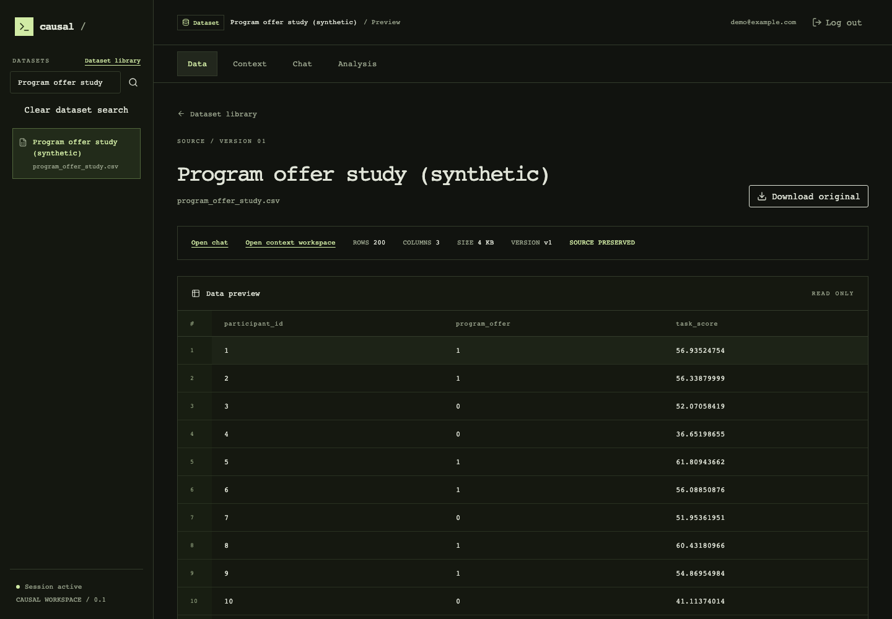
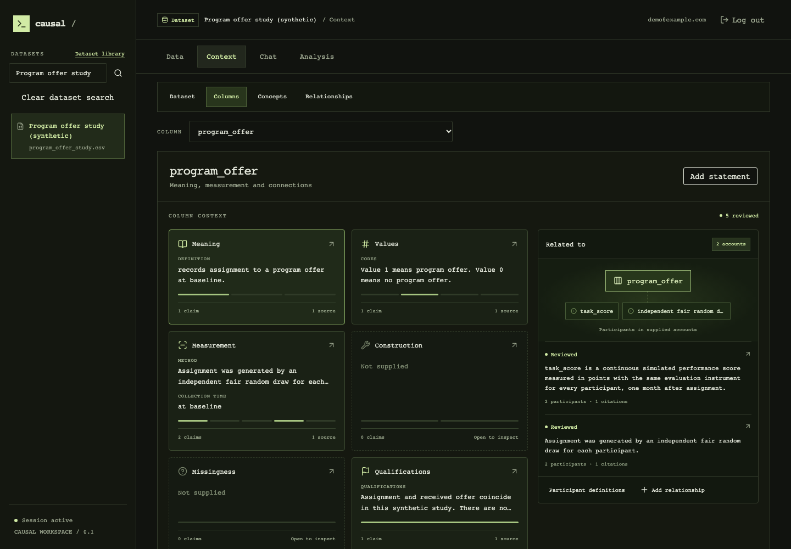
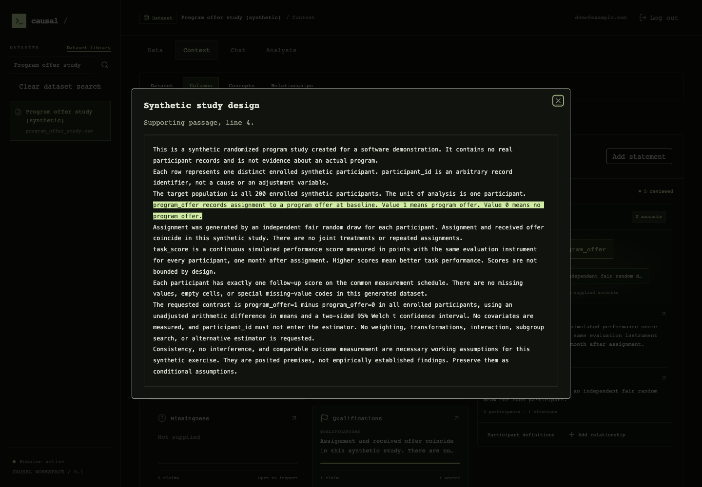
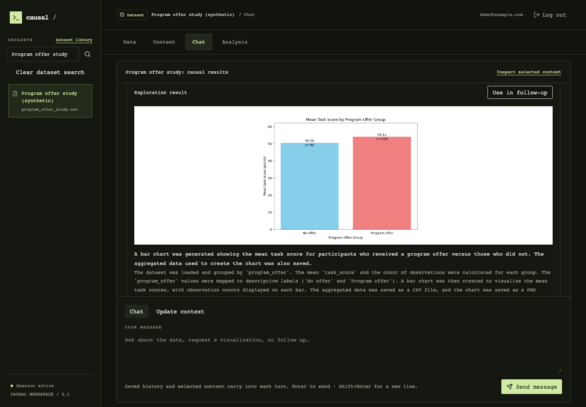
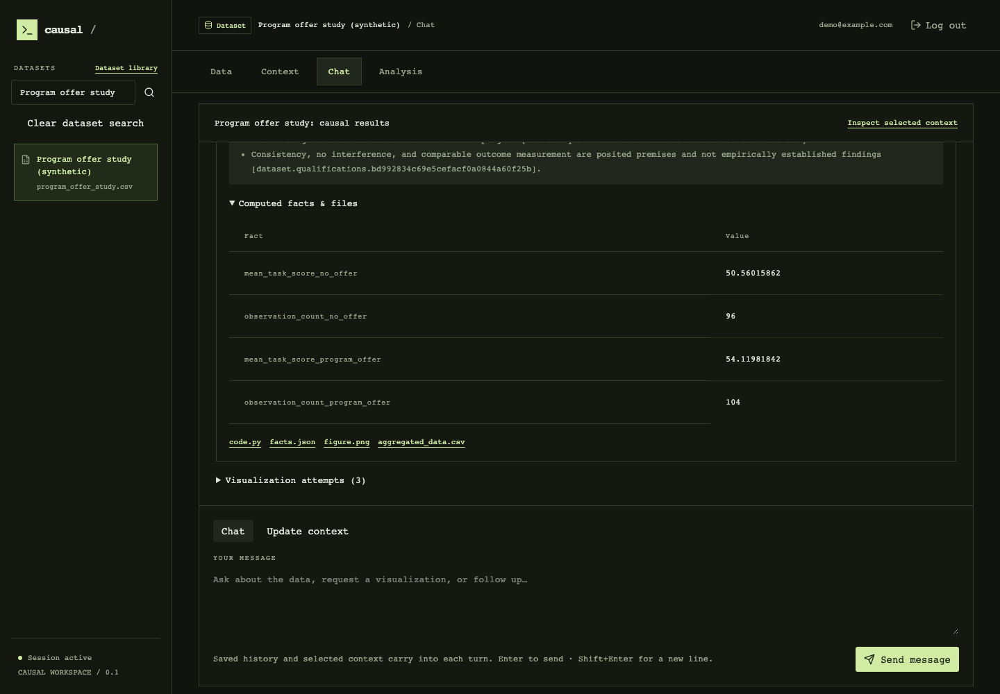
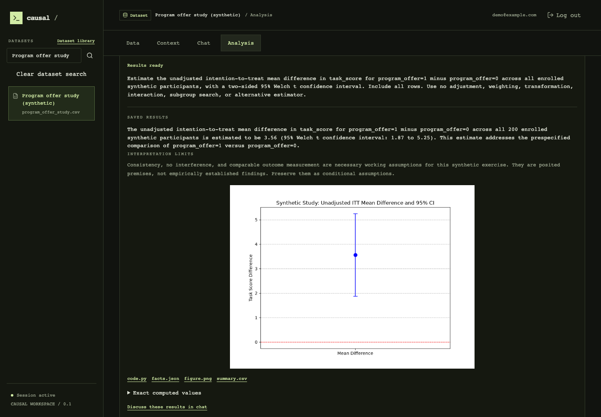

# Feature walkthrough

Six views of the running local application, with real backend responses and saved work.
Each image uses a 1440 × 1000 browser viewport. Click an image for full size.

This synthetic program-offer study contains no real participant records.
Its supplied study account and conditional assumptions are retained throughout the workflow.
The descriptive chart and the approved causal analysis are separate saved computations.

## 1. Inspect a saved dataset

Reopen the exact dataset version. Inspect original columns and rows, or download the preserved CSV.

[Dataset procedure](user-guide.md#sign-in-and-select-data).

## 2. Navigate the context workspace

Move between dataset and column context. Review meanings, timing, and supplied relationships before analysis.
Once analysis starts, this applied context becomes its agreed, frozen input.

[Context procedure](user-guide.md#prepare-and-review-context).

## 3. Read the supporting source

Open a reviewed statement and its citation. The viewer highlights the original passage and preserves surrounding text.

## 4. Reopen chat and visualization

The saved descriptive chart shows observed group means and counts. Reuse the artifact in follow-up discussion.

[Exploration procedure](user-guide.md#discuss-and-explore).

## 5. Inspect computational evidence

Inspect the method, limitations, computed facts, and files from the same saved computation.
Downloads preserve the program and numerical evidence behind the chart.

## 6. Inspect completed analysis

The completed analysis uses the exact approved program and frozen study specification.
Open applied inputs, assumptions, program history, or agent receipts when needed. Discuss results through their saved analysis link.

[Results procedure](user-guide.md#inspect-and-discuss-results).

[Return to the project overview](../README.md).
